# Memoria del Laboratorio — Failover Routing

**Grupo:** 3

**Materia:** Gestión Operativa y Seguridad en Redes (GOYS)

**Fecha de entrega:** viernes 23/10/2026

## Integrantes y roles

| Integrante | Rol |
|-----------|-----|
| Facundo Daza | R1 (Líder / Edge-WAN) + R2 (Proveedores) + R5 (QA/Ops Fase 1 y 3) |
| Irineo Hiriart | R3 (Core) + R4 (Distribución) + R5 (QA/Ops Fase 2 y 4) |

---

## 1. Diseño (F0)

### 1.1 Corrección del diagrama

| # | Defecto detectado | Corrección aplicada | Justificación |
|:-:|-------------------|---------------------|---------------|
| 1 | Subredes solapadas en la capa de acceso. | Se asignó `192.168.10.0/24` para usuarios y `192.168.20.0/24` para servidores. | Previene asimetría de enrutamiento y permite la sumarización correcta de rutas en OSPF. |
| 2 | Ausencia de enlace core-core. | Se agregó un enlace directo L3 (10.0.0.8/30) entre CORE-1 y CORE-2. | Evita la partición del backbone (área 0) y el descarte de tráfico ante la caída de enlaces cruzados. |
| 3 | HSRP mal ubicado en el Core. | Se desplazó la redundancia de gateway (VRRP) a los switches DIST-1 y DIST-2. | Libera al Core para dedicarse exclusivamente al tránsito rápido de paquetes, ubicando las políticas L3 en Distribución. |
| 4 | Firewall sin par HA (punto único de falla). | El filtrado se aplica en EDGE (F3) con un único equipo. Se documenta que en producción corresponde un par en failover activo/standby con sincronización de estado. | Con un solo equipo, su falla corta toda la salida a Internet. La doble conexión a ISP protege ante la caída de un proveedor, no ante la caída de EDGE: el lab lo acepta como limitación conocida. |
| 5 | Route Reflector iBGP mal ubicado (atravesando el firewall). | Se eliminó el RR. EDGE mantiene dos sesiones eBGP, una por ISP, sin iBGP. | Con un único router de borde no hay otros speakers iBGP a los que reflejar rutas. Las políticas de BGP quedan en el edge, no a través del firewall. |

### 1.2 Plan de direccionamiento (IPAM)

| Enlace / Red | Subred | Dispositivo A (IP/iface) | Dispositivo B (IP/iface) |
|--------------|:------:|--------------------------|--------------------------|
| ISP-1 ↔ EDGE | `203.0.113.0/30` | ISP-1 (203.0.113.1 - 0/0) | EDGE (203.0.113.2 - 0/0) |
| ISP-2 ↔ EDGE | `198.51.100.0/30`| ISP-2 (198.51.100.1 - 0/0) | EDGE (198.51.100.2 - 1/0) |
| EDGE ↔ CORE-1 | `10.0.0.0/30` | EDGE (10.0.0.1 - 2/0) | CORE-1 (10.0.0.2 - 0/0) |
| EDGE ↔ CORE-2 | `10.0.0.4/30` | EDGE (10.0.0.5 - 3/0) | CORE-2 (10.0.0.6 - 0/0) |
| CORE-1 ↔ CORE-2 (core-core) | `10.0.0.8/30` | CORE-1 (10.0.0.9 - 1/0) | CORE-2 (10.0.0.10 - 1/0) |
| CORE ↔ DIST-1 (×2) | `10.0.0.12/30` `10.0.0.20/30` | CORE-1 (10.0.0.13 - 2/0) CORE-2 (10.0.0.21 - 2/0) | DIST-1 (10.0.0.14 - 0/0) DIST-1 (10.0.0.22 - 1/0) |
| CORE ↔ DIST-2 (×2) | `10.0.0.16/30` `10.0.0.24/30` | CORE-1 (10.0.0.17 - 3/0) CORE-2 (10.0.0.25 - 3/0) | DIST-2 (10.0.0.18 - 0/0) DIST-2 (10.0.0.26 - 1/0) |
| USERS (gateway VRRP) | `192.168.10.0/24`| DIST-1 (192.168.10.2 - 2/0) | DIST-2 (192.168.10.3 - 2/0) |
| SERVERS (gateway VRRP) | `192.168.20.0/24`| DIST-1 (192.168.20.2 - 3/0) | DIST-2 (192.168.20.3 - 3/0) |

**VRRP:**

| Grupo | VRID | Master | Priority | IP virtual |
|-------|:----:|:------:|:--------:|:----------:|
| USERS | 10 | DIST-1 | 150 | `192.168.10.1` |
| SERVERS | 20 | DIST-2 | 150 | `192.168.20.1` |

**Router-IDs:** 
- EDGE: `1.1.1.1`
- CORE-1: `4.4.4.4`
- CORE-2: `5.5.5.5`
- DIST-1: `6.6.6.6`
- DIST-2: `7.7.7.7`

### 1.3 Política de seguridad

- **Usuarios y privilegios:** Usuario `admin` deshabilitado. Creación de `netadmin` (full) para configuración y `monitor` (read) para verificación.
- **Servicios que se deshabilitan:** Telnet, FTP, WWW, API, MAC-Telnet, MAC-Ping. 

- Gestión permitida: La administración de los equipos se realizará a través de la Consola local del simulador GNS3 y mediante winbox (interfaz gráfica de MikroTik) habilitado en su puerto seguro por defecto.
- **Claves de autenticación** (OSPF / BGP / VRRP): 
  - OSPF: `OspfGoys26!`
  - BGP: `BgpGoys26!`
  - VRRP: `VrrpGoys26!`

### 1.4 Política de operación

- **Formato del change log** (convención de commits): Uso estricto de Conventional Commits (`tipo(alcance): descripción`). Cada cambio debe vincularse a un rol.
- **Política de backup** (cuándo y cómo): Ejecución de `/export file=backup-<nodo>-<fecha>.rsc` e inclusión en el directorio `/backups` del repositorio tras la estabilización de cada Epic (F1, F2, F3).

---

## 2. Topología

Se implementó en GNS3 una topología de cinco capas: Internet,
Edge, Core, Distribución y Acceso. Está compuesta por siete
routers MikroTik CHR con RouterOS 7.16, dos switches Ethernet
y dos hosts VPCS, conectados mediante 15 enlaces.

Cada switch de acceso conecta su host con ambos routers de
distribución. USERS y SERVERS constituyen segmentos separados.
Se incorporó el enlace L3 directo entre CORE-1 y CORE-2.

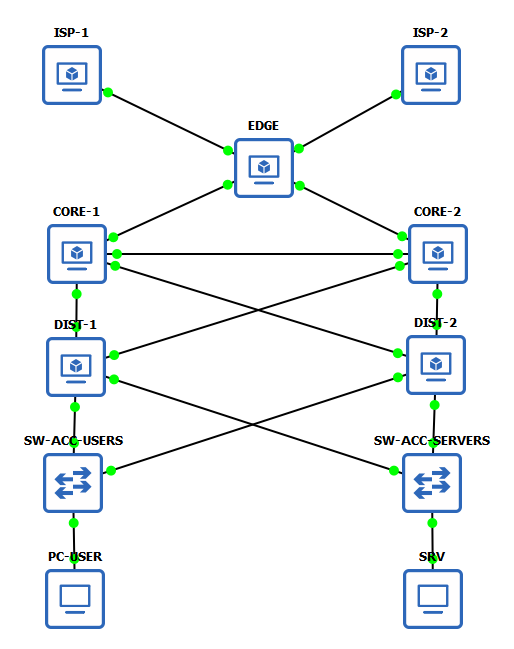

---

## 3. Configuración

### 3.1 Configuración base — F1

Se configuraron las identidades, las direcciones de los enlaces
/30, las direcciones reales de distribución en las LAN y las
loopbacks /32 sobre la interfaz lo.

| Router | Loopback |
|---|---|
| EDGE | 1.1.1.1/32 |
| ISP-1 | 2.2.2.2/32 |
| ISP-2 | 3.3.3.3/32 |
| CORE-1 | 4.4.4.4/32 |
| CORE-2 | 5.5.5.5/32 |
| DIST-1 | 6.6.6.6/32 |
| DIST-2 | 7.7.7.7/32 |

PC-USER tiene 192.168.10.100/24 y gateway 192.168.10.1.
SRV tiene 192.168.20.100/24 y gateway 192.168.20.1.

Los gateways virtuales quedan reservados para VRRP en F2.
Los clientes DHCP preconfigurados en ether1 fueron deshabilitados.

Las configuraciones de OSPF, VRRP y BGP quedan pendientes para
F2 y F3. Los exports de la configuración base están en backups/.

### 3.2 VRRP y OSPF — F2

**OSPF.** Instancia `ospf-main` (v2) con área `backbone` (0.0.0.0) en
EDGE, CORE-1, CORE-2, DIST-1 y DIST-2. El router-id de cada equipo es
su loopback. Una única interface-template cubre `10.0.0.0/24`
(`type=ptp`, MD5), por lo que incluye todos los enlaces /30 internos y
el enlace core-core. Las loopbacks y las LAN de DIST se anuncian como
pasivas. Los enlaces con los ISP quedan fuera de OSPF (BGP en F3).

**VRRP.** Dos grupos en DIST-1 y DIST-2 con reparto de carga:

| Grupo | VRID | Interfaz | IP virtual | MAC virtual | Master (prio 150) | Backup (prio 100) |
|-------|:----:|:--------:|:----------:|:-----------:|:-----------------:|:-----------------:|
| USERS | 10 | ether3 | `192.168.10.1` | `00:00:5E:00:01:0A` | DIST-1 | DIST-2 |
| SERVERS | 20 | ether4 | `192.168.20.1` | `00:00:5E:00:01:14` | DIST-2 | DIST-1 |

Los scripts aplicados están en `configs/`:
`F2-edge.rsc`, `F2-core-1.rsc`, `F2-core-2.rsc`, `F2-dist-1.rsc`,
`F2-dist-2.rsc`, `F2-vrrp-dist-1.rsc` y `F2-vrrp-dist-2.rsc`.

---

## 4. Verificación

### 4.1 Verificación de F1

Se verificó conectividad mediante ping en los nueve enlaces
directos entre routers. También se comprobó que PC-USER alcanza
192.168.10.2 y 192.168.10.3, y que SRV alcanza 192.168.20.2
y 192.168.20.3.

Las pruebas se realizaron nuevamente después del hardening,
con resultados satisfactorios. Las evidencias se encuentran
en capturas/F1/.

La conectividad entre redes y los simulacros de failover quedan
pendientes para las fases posteriores.

### 4.2 Verificación de F2

**OSPF.** Los cinco routers muestran sus vecinos en estado Full
sobre los enlaces /30, incluido el core-core. EDGE aprende por OSPF
las redes internas, entre ellas las LAN 192.168.10.0/24 y
192.168.20.0/24.

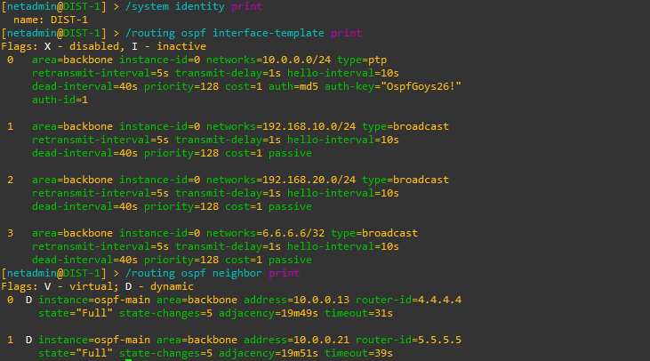
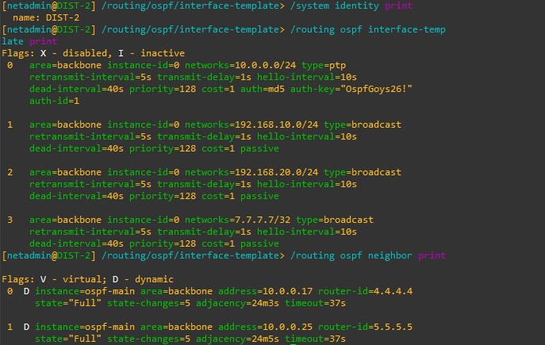
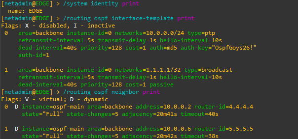
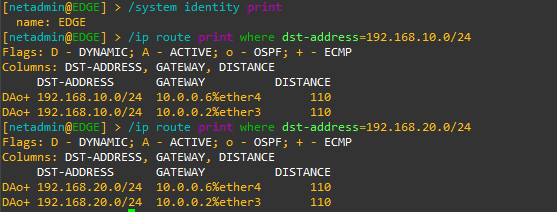

**VRRP.** `/interface vrrp print` muestra a DIST-1 como master del
grupo 10 y a DIST-2 como master del grupo 20.

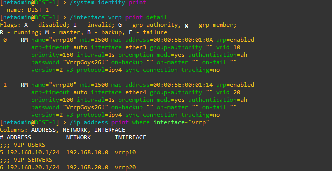
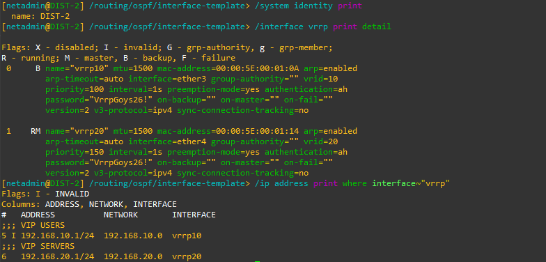

**Capa 3.** PC-USER alcanza su gateway virtual (192.168.10.1), el
gateway virtual de SERVERS y el host SRV. SRV alcanza su gateway
virtual (su tabla ARP muestra la MAC virtual `00:00:5e:00:01:14`) y
PC-USER. Con un ping continuo de PC-USER al gateway virtual se apagó
el master del grupo 10: se perdieron pocos paquetes y el servicio se
recuperó solo; al volver a encender DIST-1, recuperó el rol master.

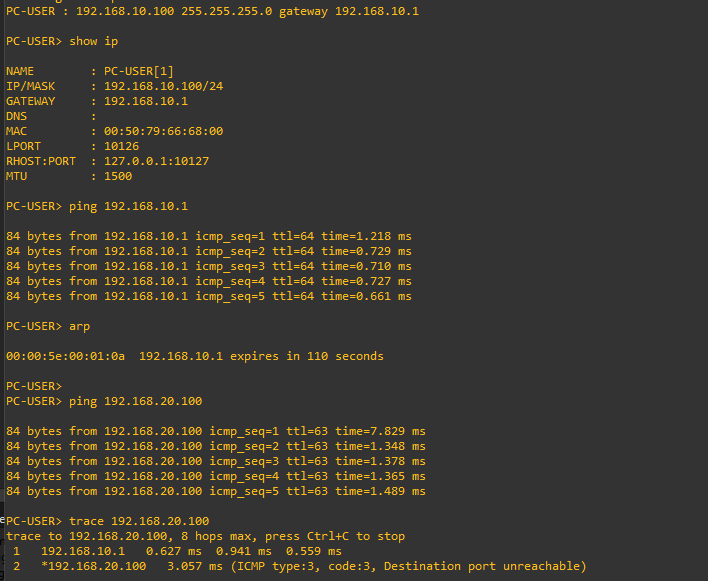
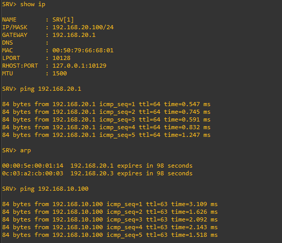
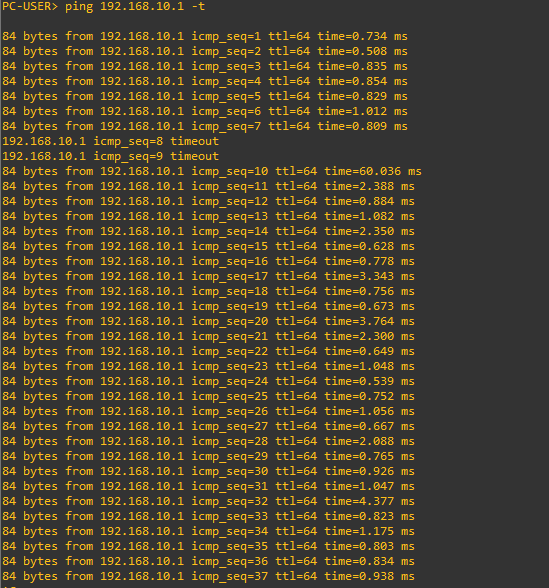

---

## 5. Seguridad aplicada

### 5.1 Hardening de F1

En los siete routers se creó netadmin con grupo full y monitor
con un grupo personalizado denominado monitoring, cuyos
permisos son local, read y winbox. Se deshabilitó el usuario admin.

Se deshabilitaron Telnet, FTP, HTTP, HTTPS, SSH, API y API-SSL.
Winbox por IP quedó habilitado. También se deshabilitaron
MAC-Telnet, MAC-Winbox y MAC-Ping.

En los ISP se conservaron activas únicamente las interfaces
ether1. En EDGE, CORE y DIST se conservaron ether1 a ether4,
deshabilitando las interfaces Ethernet restantes.

Se verificaron usuarios, permisos, servicios e interfaces en
los siete routers. El ingreso con monitor y la consulta de
direcciones se probaron en ISP-1.

La autenticación de los protocolos de enrutamiento y el
firewall de EDGE quedan pendientes para las fases posteriores.

### 5.2 Autenticación de F2

- **OSPF:** MD5 (`auth=md5`, `auth-id=1`) en todos los enlaces /30
  internos, con la clave definida en 1.3.
- **VRRP:** autenticación AH en ambos grupos, con la clave definida
  en 1.3. RouterOS 7.16 requiere `version=2` para usar autenticación.

La prueba con clave incorrecta se documentará en F4.

---

## 6. Gestión operativa

### 6.1 Change log

Registro de commits de `main` (orden cronológico). Los commits de F0 y F1 son anteriores a la convención de etiqueta de rol.

| Fase | Commit | Mensaje | Rol |
|:----:|:------:|---------|:---:|
| F0 | `0d14cd5` | chore: crear estructura inicial del proyecto | — |
| F0 | `32ebfb0` | docs(backlog): inicializo backlog con tareas y roles para F0 | — |
| F0 | `f90c412` | docs(backlog): inicializo backlog con tareas y roles para F0 | — |
| F0 | `dc75ea5` | docs(memoria): inicializo planilla de memoria tecnica | — |
| F0 | `edff198` | docs(diseño): completar IPAM, politicas de seguridad y backlog para fase F0 | — |
| F0 | `bf0e5fc` | chore(merge): resolver conflictos sobrescribiendo main con diseño F0 | — |
| F0 | `d69c615` | Merge pull request #1 from Shelldaza/docs/f0 | — |
| F1 | `6fa5e60` | feat(backups): agregar archivos .rsc de exportacion hardening e IPAM para core-1, core-2, dist-1 y dist-2 | — |
| F1 | `e0ed544` | docs(capturas): evidencias de despliegue de topologia, conectividad L3 y hardening para F1 | — |
| F1 | `abb80e0` | docs(f1): agrego evidencias de edge proveedores hosts y snapshot BASE | — |
| F1 | `1753f9c` | feet(backup): agregar exports F1 de edge y proveedores (tipo `feet` por `feat`) | — |
| F1 | `2522bb2` | docs(f1): actualizo readme backlog y memoria con cierre de fase | — |
| F2 | `6cb1dab` | feat(ospf): OSPF area 0 con MD5 en core-1 y core-2 | R3 |
| F2 | `c8fea4c` | docs(capturas): evidencia OSPF core-core core-1 y core-2 | R5 |
| F2 | `04fc6a3` | feat(ospf): OSPF area 0 con MD5 en EDGE, DIST-1 y DIST-2 | R3 |
| F2 | `4b5ee96` | docs(capturas): evidencia OSPF en EDGE, DIST-1 y DIST-2 | R5 |
| F2 | `764af58` | docs(capturas): actualizo evidencia OSPF de CORE-1 y CORE-2 con 4 vecinos | R5 |
| F2 | `3b011a8` | feat(vrrp): vrid 10 master y vrid 20 backup con auth en DIST-1 | R4 |
| F2 | `aee423a` | feat(vrrp): vrid 20 master y vrid 10 backup con auth en DIST-2 | R4 |
| F2 | `60c572a` | docs(capturas): evidencias VRRP con auth y reparto de carga en DIST-1 y DIST-2 | R5 |
| F2 | `32ba4a6` | docs(capturas): evidencia verificacion L3 PC-USER y SRV via VIP (rol escrito `[5]` por `[R5]`) | R5 |
| F2 | `5d8e433` | docs(capturas): evidencia failover VRRP con ping continuo | R5 |
| F2 | `6400ae6` | docs(backlog): marcar F2 (VRRP + OSPF + L3) como hecho | R5 |
| F2 | `2562310` | docs(memoria): documentar configuracion, verificacion y seguridad de F2 | R5 |

### 6.2 Backups

Se generaron y guardaron en backups/ los siete exports de F1,
con nombres backup-<nodo>-2026-10-09.rsc.

Estos exports contienen la configuración textual exportable.
Los archivos obtenidos no incluyen los usuarios netadmin y
monitor, sus contraseñas ni la deshabilitación de admin; esos
elementos deben reponerse al restaurar desde los exports.

Al cerrar F2 se generaron los exports posteriores a la configuración
de OSPF y VRRP de EDGE, CORE-1, CORE-2, DIST-1 y DIST-2, con nombres
backup-<nodo>-2026-10-15.rsc. Los ISP no cambiaron en F2 y conservan
su export del 09/10. Los exports incluyen las instancias OSPF, las
interface-templates con `auth-key` MD5 en texto plano, y los grupos
VRRP con `authentication=ah`. La contraseña de VRRP no aparece en el
export, por lo que debe volver a cargarse al restaurar (clave de 1.3).

Se creó en GNS3 el snapshot BASE con los nodos detenidos,
después de configurar y verificar direccionamiento y hardening.
El snapshot conserva el estado base del proyecto.

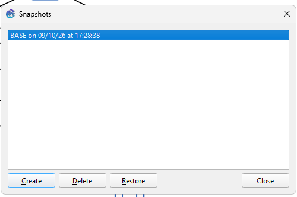

La prueba de restauración queda pendiente.

### 6.3 Monitoreo

> *Nota: La configuración y los resultados del monitoreo continuo (SNMP y chequeos de estado) se incluirán durante la ejecución de la Fase F4.*

---

## 7. Capturas

> *Nota: El directorio y los enlaces a las evidencias visuales de los estados del sistema, tablas de enrutamiento y simulacros se integrarán en las fases operativas correspondientes.*

---

## 8. Conclusiones y lecciones aprendidas

> *Nota: El análisis post-mortem global y las conclusiones técnicas sobre la resiliencia de la arquitectura diseñada se redactarán al concluir la Fase F5.*

---

## 9. Referencias

- Documentación oficial de MikroTik RouterOS (VRRP, OSPF, BGP).
- RFC 5798 (Virtual Router Redundancy Protocol).
- RFC 2328 (OSPF Version 2).
- Diapositivas y material de cátedra: "Failover Routing".

---

## 10. Checklist de entrega

### Diseño (F0)
- [x] IPAM completo y sin solapamiento
- [x] Corrección del diagrama justificada (≥ 3 defectos)
- [x] Política de seguridad definida (usuarios, servicios, claves)
- [x] Política de operación definida (change log + backup)

### Redes
- [ ] 7 CHR + 2 switches + 2 hosts levantados y cableados
- [x] VRRP operativo (2 grupos, load-sharing)
- [x] OSPF área 0 con adyacencias (incluido core–core)
- [ ] BGP eBGP ×2 establecido (multi-homing)
- [ ] Los 5 drills ejecutados y documentados (runbook + post-mortem + tiempo)

### Seguridad
- [ ] Hardening aplicado (password, usuario mínimo, servicios apagados)
- [x] OSPF MD5 funcionando
- [ ] BGP TCP-MD5 funcionando
- [x] VRRP auth funcionando
- [ ] Firewall edge aplicado
- [ ] Prueba con clave incorrecta → debe **fallar** (documentado)

### Operación
- [ ] Change log completo (refleja los commits del repo)
- [ ] Backups con restore probado
- [ ] Monitoreo habilitado y documentado
- [ ] Runbook por drill + post-mortem global

### Entrega
- [ ] Memoria completa (todas las secciones de esta plantilla)
- [ ] Repo git con la estructura correcta y commits por rol
- [ ] `backlog.md` con todas las tareas en "done"
- [ ] Capturas en la carpeta `capturas/`
- [ ] Cada integrante puede defender su parte **y** una parte ajena