# Memoria del Laboratorio — Failover Routing

**Grupo:** 3

**Materia:** Gestión Operativa y Seguridad en Redes (GOYS)

**Fecha de entrega:** viernes 23/10/2026

## Integrantes y roles

| Integrante | Rol |
|-----------|-----|
| Facundo Daza | R1 (Líder / Edge-WAN) + R2 (Proveedores) + R5 (QA/Ops Fases 1 y 3) |
| Irineo Hiriart | R3 (Core) + R4 (Distribución) + R5 (QA/Ops Fases 2 y 4) |

---

## 1. Diseño (F0)

### 1.1 Corrección del diagrama

| # | Defecto detectado | Corrección aplicada | Justificación |
|:-:|-------------------|---------------------|---------------|
| 1 | Subredes solapadas entre segmentos de acceso del diagrama original. | Se asignó `192.168.10.0/24` para usuarios y `192.168.20.0/24` para servidores. | Evita ambigüedades de direccionamiento y permite anunciar y enrutar cada red correctamente. |
| 2 | Ausencia de enlace core-core. | Se agregó un enlace directo L3 (`10.0.0.8/30`) entre CORE-1 y CORE-2. | Proporciona un camino adicional dentro del backbone OSPF y mejora la conectividad ante determinadas fallas de enlace. |
| 3 | Redundancia de gateway ubicada en el Core. | Se desplazó la redundancia de gateway a los routers CHR DIST-1 y DIST-2 mediante VRRP. | Mantiene al Core como capa de tránsito y ubica los gateways de las LAN en Distribución. |
| 4 | Firewall sin par HA, constituyendo un punto único de falla. | Se implementó el filtrado en un único EDGE, conforme a la topología del laboratorio, y se documentó la necesidad de un par en failover con sincronización de estado en producción. | La doble conexión a ISP protege frente a la caída de un proveedor, pero no frente a la caída de EDGE. Esta es una limitación conocida del laboratorio. |
| 5 | Route Reflector iBGP mal ubicado en el diagrama original. | Se eliminó el RR. EDGE mantiene dos sesiones eBGP, una por ISP, sin iBGP. | Con un único router de borde no hay otros speakers iBGP a los que reflejar rutas. Las sesiones con los proveedores corresponden a eBGP. |

### 1.2 Plan de direccionamiento (IPAM)

Las interfaces de la tabla corresponden a sus nombres reales en RouterOS.

| Enlace / Red | Subred | Dispositivo A (IP / interfaz) | Dispositivo B (IP / interfaz) |
|--------------|--------|-------------------------------|-------------------------------|
| ISP-1 ↔ EDGE | `203.0.113.0/30` | ISP-1: `203.0.113.1`, ether1 | EDGE: `203.0.113.2`, ether1 |
| ISP-2 ↔ EDGE | `198.51.100.0/30` | ISP-2: `198.51.100.1`, ether1 | EDGE: `198.51.100.2`, ether2 |
| EDGE ↔ CORE-1 | `10.0.0.0/30` | EDGE: `10.0.0.1`, ether3 | CORE-1: `10.0.0.2`, ether1 |
| EDGE ↔ CORE-2 | `10.0.0.4/30` | EDGE: `10.0.0.5`, ether4 | CORE-2: `10.0.0.6`, ether1 |
| CORE-1 ↔ CORE-2 | `10.0.0.8/30` | CORE-1: `10.0.0.9`, ether2 | CORE-2: `10.0.0.10`, ether2 |
| CORE-1 ↔ DIST-1 | `10.0.0.12/30` | CORE-1: `10.0.0.13`, ether3 | DIST-1: `10.0.0.14`, ether1 |
| CORE-1 ↔ DIST-2 | `10.0.0.16/30` | CORE-1: `10.0.0.17`, ether4 | DIST-2: `10.0.0.18`, ether1 |
| CORE-2 ↔ DIST-1 | `10.0.0.20/30` | CORE-2: `10.0.0.21`, ether3 | DIST-1: `10.0.0.22`, ether2 |
| CORE-2 ↔ DIST-2 | `10.0.0.24/30` | CORE-2: `10.0.0.25`, ether4 | DIST-2: `10.0.0.26`, ether2 |
| USERS | `192.168.10.0/24` | DIST-1: `192.168.10.2`, ether3 | DIST-2: `192.168.10.3`, ether3 |
| SERVERS | `192.168.20.0/24` | DIST-1: `192.168.20.2`, ether4 | DIST-2: `192.168.20.3`, ether4 |

**Hosts:**

| Host | Dirección | Gateway |
|------|-----------|---------|
| PC-USER | `192.168.10.100/24` | `192.168.10.1` |
| SRV | `192.168.20.100/24` | `192.168.20.1` |

**VRRP:**

| Grupo | VRID | Master preferido | Prioridad master / backup | IP virtual |
|-------|:----:|------------------|:-------------------------:|------------|
| USERS | 10 | DIST-1 | 150 / 100 | `192.168.10.1` |
| SERVERS | 20 | DIST-2 | 150 / 100 | `192.168.20.1` |

**Loopbacks y Router-IDs:**

| Router | Loopback | Uso como Router-ID |
|--------|----------|-------------------|
| EDGE | `1.1.1.1/32` | OSPF y BGP |
| ISP-1 | `2.2.2.2/32` | BGP |
| ISP-2 | `3.3.3.3/32` | BGP |
| CORE-1 | `4.4.4.4/32` | OSPF |
| CORE-2 | `5.5.5.5/32` | OSPF |
| DIST-1 | `6.6.6.6/32` | OSPF |
| DIST-2 | `7.7.7.7/32` | OSPF |

Las loopbacks se configuraron sobre la interfaz `lo`. Estas direcciones se utilizan dentro del laboratorio aislado.

**Sistemas autónomos:**

| Equipo | AS |
|--------|----|
| EDGE | 65000 |
| ISP-1 | 65001 |
| ISP-2 | 65002 |

### 1.3 Política de seguridad

- **Usuarios y privilegios:** usuario `admin` deshabilitado; `netadmin` con grupo `full` para configuración y `monitor` con el grupo personalizado `monitoring`, cuyos permisos son `local,read,winbox`.
- **Servicios deshabilitados:** Telnet, FTP, HTTP, HTTPS, SSH, API y API-SSL. También MAC-Telnet, MAC-Winbox y MAC-Ping.
- **Gestión permitida:** consola local de GNS3 y Winbox por IP. En EDGE, desde F3, Winbox se limita a `192.168.10.100/32` mediante el servicio y el firewall. El puerto predeterminado no constituye por sí solo una medida de seguridad.
- **Interfaces:** se deshabilitan las interfaces Ethernet que no participan en la topología.
- **Direccionamiento:** se utiliza configuración estática. Los clientes DHCP preconfigurados en ether1 se mantienen deshabilitados.
- **Claves de autenticación:** cada protocolo utiliza una clave distinta. No se versionan las claves OSPF, BGP ni VRRP. En las copias destinadas al repositorio se reemplazan los valores visibles por `<CLAVE_OSPF>`, `<CLAVE_BGP>`, `<CLAVE_VRRP>` o `REDACTED`; otros valores sensibles pueden quedar omitidos por el propio export.
- **Rotación:** las claves iniciales de F0 se publicaron por error y se retiraron. Se documentó su rotación el 15/10/2026 y se configuró una clave BGP nueva al implementar F3 el 16/10/2026.
- **Intercambio de claves:** se guardan fuera del repositorio y se comparten entre los integrantes por mensajería privada.

La mensajería privada no reemplaza a un gestor de secretos: las claves quedan en el historial y no existe una auditoría específica de acceso y rotación. Se acepta como mecanismo del laboratorio; en producción corresponde un gestor de secretos con control de acceso y auditoría.

### 1.4 Política de operación

**Gestión de cambios.** Se utiliza Conventional Commits:

`tipo(alcance): descripción [ROL]`

Cada cambio debe representar una unidad lógica y vincularse al rol correspondiente. El change log de la sección 6.1 debe reflejar el historial real del repositorio.

**Exports.** Tras estabilizar F1, F2 y F3 se ejecuta `/export file=backup-<nodo>-<fecha>` en los routers modificados. RouterOS agrega la extensión `.rsc`. Las copias para Git se guardan en `backups/`, previa revisión de claves visibles.

**Verificación de DHCP.** Antes de versionar cada export, se comprueba que el cliente DHCP de ether1 figure con `disabled=yes`. Si no coincide con la política, se revisa la configuración activa y se vuelve a exportar.

**Backups binarios.** Además del export textual, se genera `/system backup save name=backup-<nodo>-<fecha> password=<clave>`. El backup contiene usuarios y claves, por lo que se cifra con una contraseña guardada fuera del repositorio. Los archivos `.backup` permanecen en el almacenamiento de los routers y no se versionan; `*.backup` está incluido en `.gitignore`. Su existencia se documenta mediante `/file print`.

Mantener el backup únicamente dentro del router es una limitación operativa: no protege frente a la pérdida del almacenamiento del proyecto.

**Pruebas de restauración.** Al cerrar cada fase con backup se prueba la restauración de un nodo, preferentemente sobre una copia aislada del proyecto:

1. Generar el export y registrar el estado de referencia.
2. Restablecer el nodo de prueba sin configuración predeterminada.
3. Importar el `.rsc`.
4. Reponer las claves vigentes de OSPF, BGP y VRRP que correspondan. Los valores `REDACTED` no son claves válidas.
5. Recrear los usuarios `netadmin` y `monitor`, asignar sus contraseñas y deshabilitar `admin` después de comprobar el acceso administrativo.
6. Comparar direcciones, servicios, reglas y protocolos con el estado de referencia.

Revertir un commit de configuración no modifica automáticamente los routers: la reversión operativa debe ejecutarse y verificarse por separado.

---

## 2. Topología

Se implementó en GNS3 una topología de cinco capas: Internet, Edge, Core, Distribución y Acceso. Está compuesta por siete routers MikroTik CHR con RouterOS 7.16, dos switches Ethernet y dos hosts VPCS, conectados mediante 15 enlaces.

Cada switch de acceso conecta su host con ambos routers de distribución. USERS y SERVERS constituyen segmentos separados. Se incorporó el enlace L3 directo entre CORE-1 y CORE-2.

Los routers ISP simulan los proveedores externos. No se requiere conexión a Internet real para las pruebas previstas.

---

## 3. Configuración

### 3.1 Configuración base — F1

Se configuraron las identidades, las direcciones de los enlaces /30, las direcciones reales de distribución en las LAN y las loopbacks /32 sobre la interfaz `lo`, conforme al IPAM.

PC-USER tiene `192.168.10.100/24` y gateway `192.168.10.1`. SRV tiene `192.168.20.100/24` y gateway `192.168.20.1`.

Al finalizar F1, los gateways virtuales quedaron reservados para VRRP en F2. Los clientes DHCP preconfigurados en ether1 se deshabilitaron.

Los exports de la configuración base se encuentran en `backups/`. OSPF, VRRP y BGP se implementaron posteriormente, como se describe en las secciones siguientes.

### 3.2 VRRP y OSPF — F2

**OSPF.** Se configuró la instancia `ospf-main` de OSPFv2 con área `backbone` (`0.0.0.0`) en EDGE, CORE-1, CORE-2, DIST-1 y DIST-2. El Router-ID de cada equipo corresponde a su loopback.

Una interface-template cubre `10.0.0.0/24`, con `type=ptp` y autenticación MD5. Esa selección incluye todos los enlaces /30 internos y el enlace core-core. Las loopbacks y las LAN de distribución se anuncian mediante interfaces pasivas.

Los enlaces entre EDGE y los ISP quedan fuera de OSPF y utilizan BGP desde F3.

**VRRP.** Se configuraron dos grupos en ambos routers de distribución:

| Grupo | VRID | Interfaz | IP virtual | MAC virtual | Master preferido, prioridad 150 | Backup, prioridad 100 |
|-------|:----:|----------|------------|-------------|--------------------------------|----------------------|
| USERS | 10 | ether3 | `192.168.10.1` | `00:00:5E:00:01:0A` | DIST-1 | DIST-2 |
| SERVERS | 20 | ether4 | `192.168.20.1` | `00:00:5E:00:01:14` | DIST-2 | DIST-1 |

Se utiliza VRRPv2 con autenticación AH. Cada router es master preferido de una LAN y backup de la otra.

Los scripts aplicados en F2 están en `configs/`:

- `F2-edge.rsc`
- `F2-core-1.rsc`
- `F2-core-2.rsc`
- `F2-dist-1.rsc`
- `F2-dist-2.rsc`
- `F2-vrrp-dist-1.rsc`
- `F2-vrrp-dist-2.rsc`

### 3.3 BGP y salida al exterior — F3

EDGE pertenece al AS 65000 y mantiene dos sesiones eBGP: una con ISP-1, AS 65001, y otra con ISP-2, AS 65002. Ambas utilizan autenticación TCP-MD5.

| Conexión en EDGE | IP local | IP del vecino | AS remoto |
|-----------------|----------|---------------|-----------|
| F3-ISP-1 | `203.0.113.2` | `203.0.113.1` | 65001 |
| F3-ISP-2 | `198.51.100.2` | `198.51.100.1` | 65002 |

Se configuró `output.redistribute=ospf` en EDGE. El filtro `F3-EDGE-OUT` permite anunciar únicamente `192.168.10.0/24` y `192.168.20.0/24`, rechazando los demás prefijos.

Los filtros de entrada de los ISP aceptan únicamente esas dos LAN. Cada ISP anuncia su propia loopback mediante redistribución de conectadas, limitada por su filtro de salida, y una ruta por defecto mediante `output.default-originate=always`.

EDGE acepta desde ISP-1 `2.2.2.2/32` y la default; desde ISP-2 acepta `3.3.3.3/32` y la default. Los demás prefijos quedan rechazados.

La default recibida de ISP-1 tiene `bgp-local-pref=200`; la de ISP-2, `bgp-local-pref=100`. Se establece así una salida preferida por ISP-1 y una alternativa por ISP-2. Las rutas específicas a las loopbacks utilizan el proveedor que las anuncia.

En la instancia `ospf-main` de EDGE se configuró `originate-default=if-installed`, para anunciar una ruta por defecto al interior cuando EDGE tiene una instalada. No se redistribuye la tabla BGP completa hacia OSPF.

No se configuró NAT: los ISP aprenden las LAN mediante BGP y disponen de rutas de retorno hacia los hosts.

El exterior es simulado. Las pruebas utilizan las loopbacks de los proveedores; no representan acceso a Internet real. La loopback de cada ISP depende de ese proveedor y no constituye un destino común accesible a través de ambos.

Durante la revisión de los exports se detectaron dos conexiones BGP duplicadas en EDGE. Se deshabilitaron, se comprobó que las dos sesiones necesarias continuaban establecidas y luego se eliminaron. Finalmente se regeneró el export de EDGE.
Las configuraciones completas posteriores a F3 se encuentran en:

- configs/F3-edge.rsc
- configs/F3-isp-1.rsc
- configs/F3-isp-2.rsc

Estos archivos son exports completos del estado de cada router,
no scripts incrementales para aplicar sobre una configuración existente.
Para restaurarlos se requiere un equipo de prueba sin configuración,
reponer las claves omitidas o censuradas y recrear los usuarios.

Los mismos estados se conservan en backups/ mediante archivos fechados.

### 3.4 Firewall de EDGE — F3

Se crearon las siguientes listas:

| Lista | Miembros |
|-------|----------|
| F3-WAN | ether1 y ether2 |
| F3-CORE | ether3 y ether4 |
| F3-LANS, de direcciones | `192.168.10.0/24` y `192.168.20.0/24` |

La cadena `input` permite conexiones establecidas y relacionadas, descarta conexiones inválidas y autoriza:

- BGP TCP/179 desde cada ISP por su interfaz correspondiente.
- OSPF desde cada CORE por su interfaz correspondiente.
- ICMP para diagnóstico.
- Winbox TCP/8291 desde `192.168.10.100`, ingresando por los enlaces internos.

Una regla final descarta el resto del tráfico dirigido a EDGE. Además, el servicio Winbox se restringió a `192.168.10.100/32`.

La cadena `forward` permite conexiones establecidas y relacionadas, descarta conexiones inválidas y autoriza tráfico desde las LAN hacia los ISP. También permite tránsito entre las dos LAN por las interfaces internas si su recorrido atraviesa EDGE. Una regla final descarta el tráfico restante.

La consola local de GNS3 continúa disponible para administración.

Las reglas documentadas corresponden al tráfico IPv4 del laboratorio.

### 3.5 Configuración final

Durante F5 se corrigieron las máscaras de las direcciones virtuales VRRP en DIST-1 y DIST-2: 192.168.10.1/32 y 192.168.20.1/32. Las direcciones de las interfaces físicas de ambas LAN conservan /24.

Después del cambio se verificaron los roles master/backup de ambos grupos, las dos adyacencias OSPF Full de cada DIST y la conectividad desde PC-USER al gateway virtual, SRV y las loopbacks de ambos ISP. Se generaron nuevos exports de ambos DIST y se actualizaron sus configuraciones.

Las configuraciones finales exportables de los siete routers se encuentran en `configs/final/`:

| Equipo | Archivo | Export de origen |
|--------|---------|------------------|
| EDGE | `EDGE.rsc` | 16/10/2026 |
| ISP-1 | `ISP-1.rsc` | 16/10/2026 |
| ISP-2 | `ISP-2.rsc` | 16/10/2026 |
| CORE-1 | `CORE-1.rsc` | 15/10/2026 |
| CORE-2 | `CORE-2.rsc` | 15/10/2026 |
| DIST-1 | `DIST-1.rsc` | 21/10/2026 |
| DIST-2 | `DIST-2.rsc` | 21/10/2026 |

Cada archivo corresponde al último estado de configuración documentado de su equipo. Las fechas difieren porque no todos los routers recibieron cambios permanentes en cada fase.

Son exports completos con las claves visibles censuradas. Para restaurarlos deben reponerse las claves omitidas o censuradas y recrearse los usuarios conforme a la política de operación. No son scripts incrementales para aplicar sobre una configuración existente.

## 4. Verificación

### 4.1 Verificación de F1

Se verificó conectividad mediante ping en los nueve enlaces directos entre routers. También se comprobó que PC-USER alcanza `192.168.10.2` y `192.168.10.3`, y que SRV alcanza `192.168.20.2` y `192.168.20.3`.

Las pruebas se repitieron después del hardening, con resultados satisfactorios. Las evidencias se encuentran en `capturas/F1/`.

La conectividad entre redes se verificó posteriormente en F2.

### 4.2 Verificación de F2

**OSPF.** Se documentaron vecinos en estado Full sobre los enlaces /30 internos, incluido el core-core. EDGE aprendió por OSPF las redes internas, entre ellas `192.168.10.0/24` y `192.168.20.0/24`.

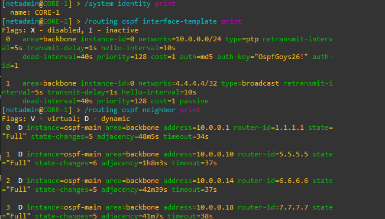

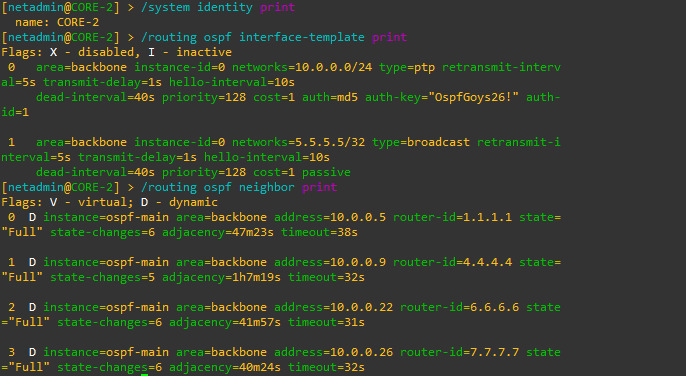

**VRRP.** `/interface vrrp print` mostró DIST-1 como master del grupo 10 y DIST-2 como master del grupo 20.

**Capa 3.** PC-USER alcanzó su gateway virtual, el gateway virtual de SERVERS y el host SRV. SRV alcanzó su gateway virtual y PC-USER. La tabla ARP de SRV mostró la MAC virtual `00:00:5e:00:01:14`.

Con un ping continuo desde PC-USER al gateway virtual se apagó el master del grupo 10. Se observaron pérdidas transitorias y recuperación automática del servicio. Al encender nuevamente DIST-1, recuperó el rol master.

Esta comprobación funcional de F2 no sustituye los drills con tiempos medidos, runbooks y post-mortem previstos para F4.

### 4.3 Verificación de F3

**Sesiones BGP.** EDGE mostró dos sesiones con bandera `E`, established, una con cada ISP. Se comprobó que las cuatro conexiones configuradas entre los tres routers tienen una clave TCP-MD5 no vacía, sin mostrar sus valores en las evidencias.

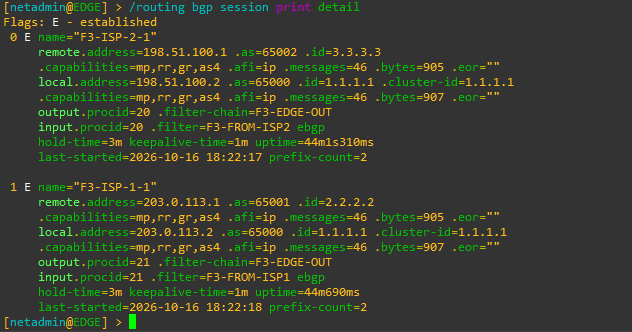

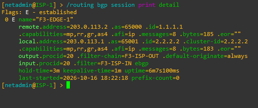

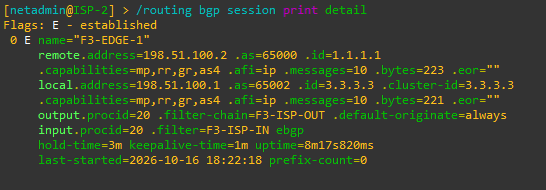

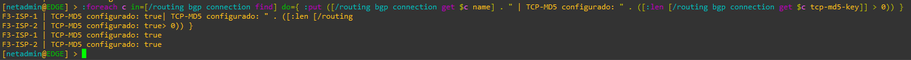

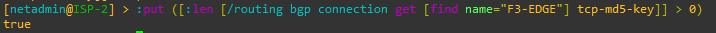

**Rutas BGP.** Ambos ISP instalaron rutas BGP activas hacia las dos LAN con EDGE como siguiente salto. EDGE instaló las rutas a ambas loopbacks y seleccionó la default de ISP-1, conservando la de ISP-2 como alternativa.

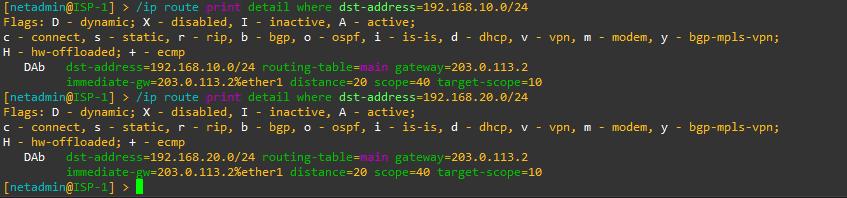

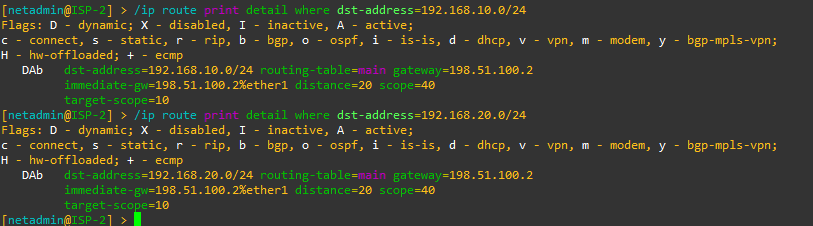

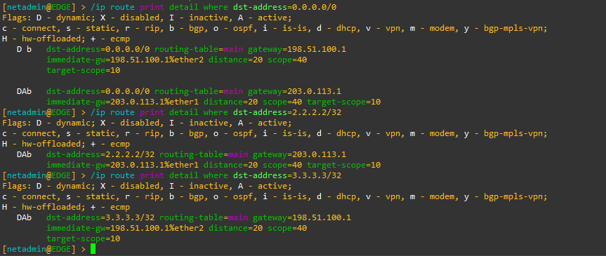

**Salida anunciada por OSPF.** EDGE mantuvo sus dos vecinos Full y anunció la default mediante `originate-default=if-installed`. DIST-1 y DIST-2 recibieron esa ruta con caminos de igual costo a través de ambos CORE.

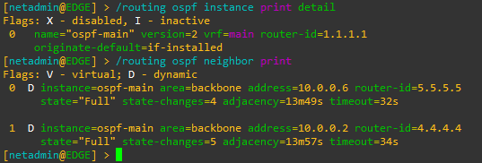

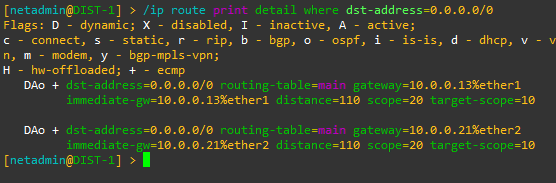

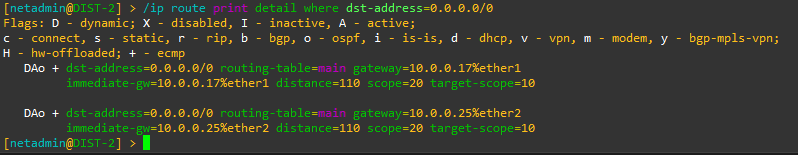

**Conectividad.** PC-USER alcanzó `2.2.2.2` y `3.3.3.3` mediante ping y traceroute. Después de aplicar el firewall continuó alcanzando ambas loopbacks y el host SRV.

En las trazas UDP, el mensaje final ICMP Destination port unreachable provino del destino y confirmó la llegada de las sondas. Los saltos internos variaron entre caminos disponibles.

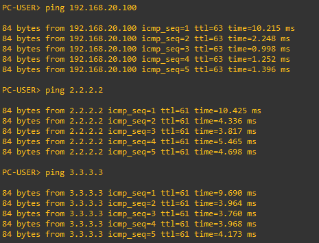

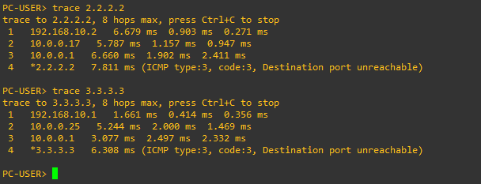

**Firewall.** Después de aplicar las reglas, ambas sesiones BGP permanecieron establecidas y los dos vecinos OSPF de EDGE continuaron en estado Full.

Se intentó establecer una conexión TCP desde ISP-1 hacia `203.0.113.2:8291`, utilizando el cliente Telnet con el comando `/system telnet address=203.0.113.2 port=8291`. El intento terminó por timeout.

Se registró el contador de la regla final de descarte antes y después de la prueba. Su incremento es consistente con el bloqueo, aunque la regla también puede contabilizar otro tráfico.

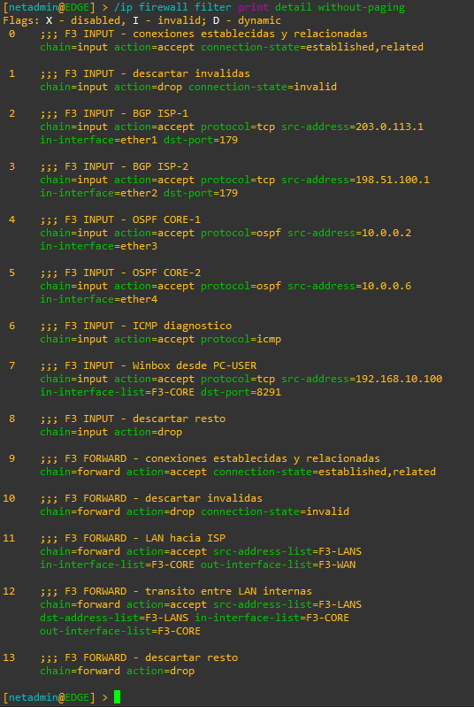

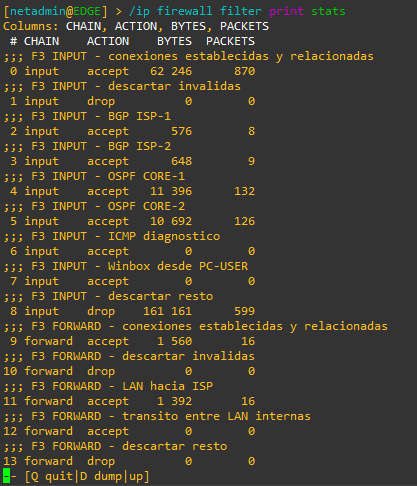

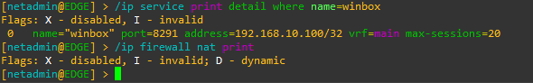

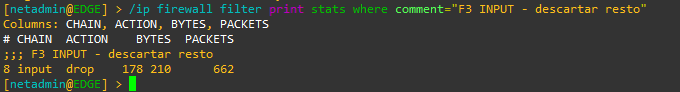

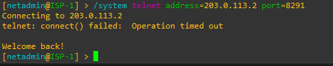

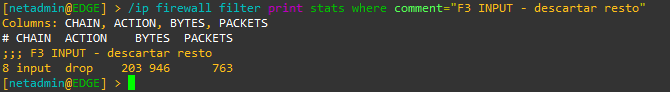

La prueba de caída de proveedor y la medición de convergencia se documentan en la sección 4.4 (F4).

### 4.4 Drills de failover, seguridad y monitoreo (F4)

Cada drill tiene su runbook en `runbooks/` con detección, respuesta, recuperación, tiempo medido y post-mortem. El análisis global está en `runbooks/post-mortem-global.md`. Los drills 4 y 5 corresponden a los escenarios de la plantilla de documentación de la cátedra.

| Drill | Escenario | Tiempo medido | Runbook |
|-------|-----------|---------------|---------|
| 1 — VRRP | Apagado de DIST-1 (master vrid 10) | ≈ 2,8 s (±1 s); 1 paquete perdido. Failback sin pérdida. | `runbooks/drill-1-vrrp.md` |
| 2 — OSPF | `ether2` de DIST-1 deshabilitada (enlace a CORE-2) | 1 paquete perdido (< 1 s); adyacencia `Full` a los 2 s de restaurar | `runbooks/drill-2-ospf.md` |
| 3 — BGP | `ether1` de ISP-1 deshabilitada | ≈ 129 s hasta Hold Timer Expired; sesión restablecida en ≈ 3 s | `runbooks/drill-3-bgp.md` |
| 4 — check-gateway | Mismo corte con ruta estática de prueba | ≈ 28 s de detección; ≈ 10 s de vuelta | `runbooks/drill-4-check-gateway.md` |
| 5 — Load-sharing VRRP | Sin falla: ambos DIST activos | No aplica | `runbooks/drill-5-load-sharing-vrrp.md` |

**Drill 1.** DIST-2 asumió ambos grupos VRRP; al volver DIST-1 recuperó vrid 10 por preemption.

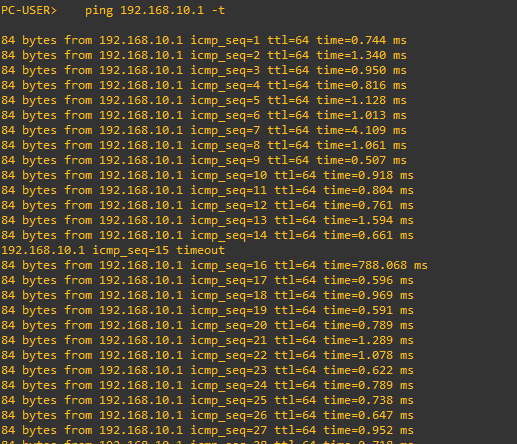

**Drill 2.** Se perdió un paquete en el corte y otro en la recuperación; el default de DIST-1 pasó de dos rutas ECMP a una y volvió a dos.

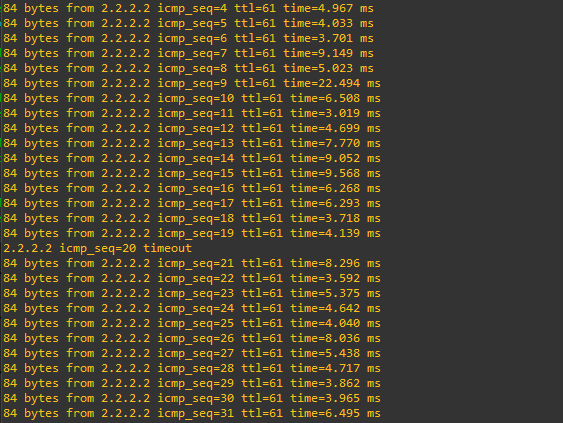

**Drill 3.** EDGE mantuvo el default por ISP-1 sobre un enlace muerto hasta vencer el hold-time (03:29:20), momento en que pasó a ISP-2. 2.2.2.2 solo es alcanzable por ISP-1, por lo que el failover se verifica por el cambio del default.

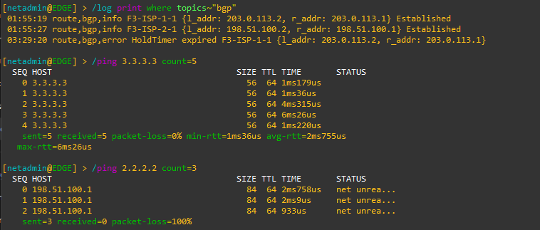

**Drill 4.** Con una ruta de prueba (9.9.9.9/32, eliminada al terminar) y `check-gateway=ping`, EDGE pasó al gateway de respaldo en ≈ 28 s, frente a ≈ 129 s de BGP.

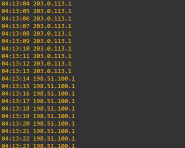

**Drill 5.** DIST-1 es master de vrid 10 y DIST-2 de vrid 20 de forma simultánea; cada host usa la VIP de su grupo.

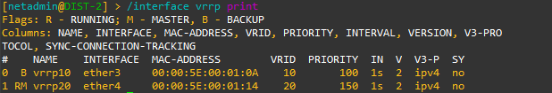

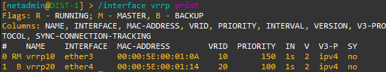

#### Verificación de seguridad: clave OSPF MD5 incorrecta

Se cambió la clave del template OSPF de CORE-1 (que cubre todos sus enlaces internos) por una clave de prueba. CORE-2 registró `authentication failed ... md5 mismatch` desde las 04:42:52 y la adyacencia con CORE-1 pasó a `Down` a las 04:43:22. Al restaurar la clave real, las cuatro adyacencias de CORE-1 se reconstruyeron. Detalle en `runbooks/verificacion-seguridad-ospf-md5.md`. La prueba se realizó solo con OSPF; no se repitió con BGP ni con VRRP.

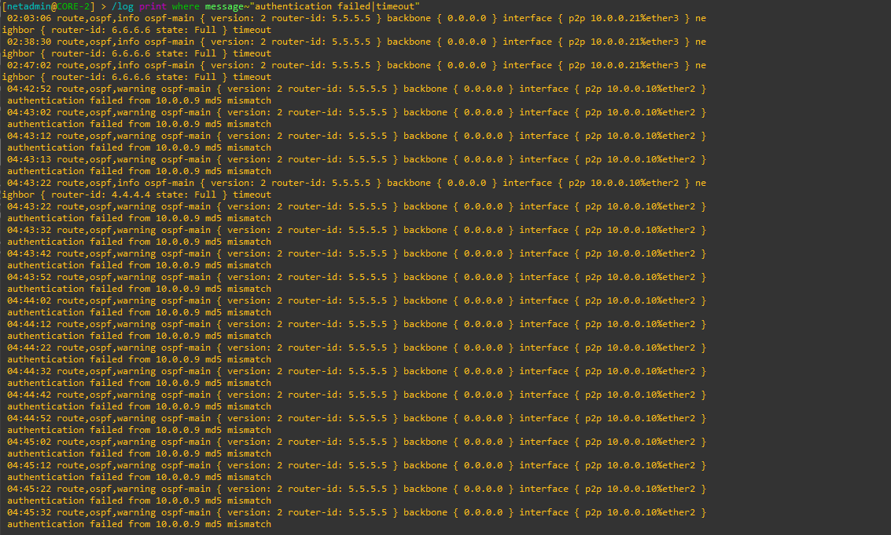

#### Limitaciones de la medición

Los pings de VPCS tienen resolución de ≈ 1 s y los relojes de los routers difieren en pocos segundos, por lo que los tiempos son aproximados. El detalle está en el post-mortem global.

### 4.5 Verificación final — F5

Después de importar el proyecto portable posterior a F4 se comprobaron las sesiones BGP de EDGE, sus vecinos OSPF y la selección de la ruta por defecto mediante ISP-1.

Tras corregir las máscaras de las VIP a /32, DIST-1 mantuvo el rol master del grupo 10 y DIST-2 el del grupo 20. Ambos conservaron dos vecinos OSPF Full. Los cinco chequeos Netwatch de DIST-1 se encontraron en estado up.

Desde PC-USER se verificó conectividad al gateway virtual de USERS, SRV y las loopbacks de ambos ISP, con cinco respuestas en cada prueba.

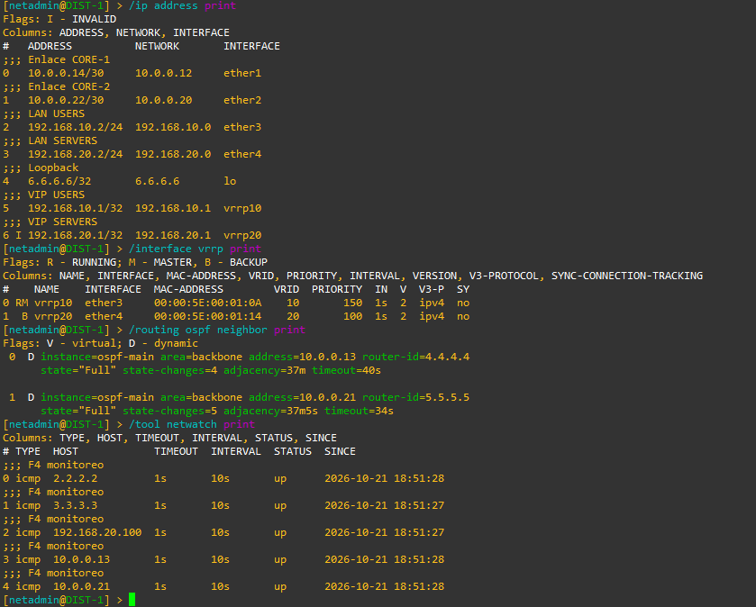

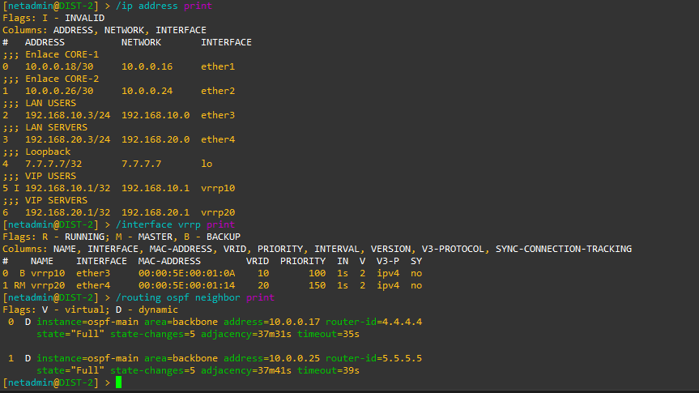

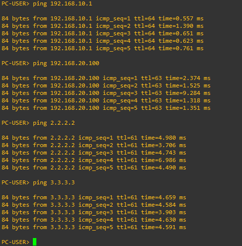

Las mediciones de los drills de F4 corresponden al estado previo a la corrección de máscaras de F5. En esta fase se repitieron las verificaciones funcionales indicadas, sin repetir las mediciones de convergencia.

## 5. Seguridad aplicada

### 5.1 Hardening de F1

En los siete routers se creó `netadmin` con grupo `full` y `monitor` con el grupo personalizado `monitoring`, cuyos permisos son `local,read,winbox`. Se deshabilitó el usuario `admin`.

Se deshabilitaron Telnet, FTP, HTTP, HTTPS, SSH, API y API-SSL. Winbox por IP quedó habilitado. También se deshabilitaron MAC-Telnet, MAC-Winbox y MAC-Ping.

El cliente DHCP preconfigurado en ether1 se deshabilitó explícitamente en los siete routers. El direccionamiento del laboratorio es estático; un cliente DHCP activo podría introducir direcciones, DNS o rutas ajenas al IPAM. Su estado se registra en los exports.

En los ISP se conservó activa únicamente ether1. En EDGE, CORE y DIST se conservaron ether1 a ether4 y se deshabilitaron las interfaces Ethernet restantes.

Se verificaron usuarios, permisos, servicios e interfaces en los siete routers. El ingreso con `monitor` y la consulta de direcciones se probaron en ISP-1.

La autenticación de los protocolos y el firewall se incorporaron en F2 y F3.

### 5.2 Autenticación de F2

- **OSPF:** MD5, con `auth=md5` y `auth-id=1`, en todos los enlaces /30 internos.
- **VRRP:** autenticación AH en ambos grupos, utilizando VRRPv2 en RouterOS 7.16.

Las claves vigentes se manejan conforme a la sección 1.3. La prueba con clave incorrecta se documenta en la sección 4.4.

### 5.3 Seguridad de F3

Las dos sesiones eBGP utilizan TCP-MD5 con una clave específica de BGP, distinta de las claves OSPF y VRRP. La clave no se incluye en el repositorio.

Los filtros BGP limitan los anuncios de EDGE a las dos LAN y restringen los prefijos aceptados desde cada proveedor.

El firewall protege el plano de control permitiendo BGP y OSPF únicamente desde los vecinos y enlaces definidos, además de las conexiones establecidas y relacionadas. Se mantiene ICMP para diagnóstico.

Winbox queda restringido a `192.168.10.100/32` tanto en el servicio como en la cadena input. Se verificó el bloqueo del puerto de gestión desde ISP-1.

La autorización de Winbox desde PC-USER se comprobó mediante la configuración. No se realizó una sesión gráfica desde ese host, que es un VPCS. La administración efectiva durante F3 se realizó mediante la consola de GNS3.

La prueba de bloqueo de gestión no sustituye la prueba de autenticación con clave incorrecta, que se realizó en F4 sobre OSPF (sección 4.4).

---

## 6. Gestión operativa

### 6.1 Change log

Registro de commits de `main` hasta `ebc84ee`, en orden cronológico. El commit de cierre que incorpora esta actualización queda fuera de este corte y puede consultarse en el historial de Git.

La columna Responsable corresponde al autor registrado en Git.
Los commits de F0 y F1 son anteriores a la convención de etiqueta de rol. Los dos commits del Drill 1 llevan la etiqueta `[5]` en lugar de `[R5]`.

Para commits ordinarios, `git revert <hash>` crea un commit inverso
sin reescribir el historial. Los commits de merge requieren seleccionar
el padre principal. Revertir archivos del repositorio no revierte
automáticamente las configuraciones activas de los routers.

| Fecha | Fase | Commit | Responsable | Mensaje | Reversión / observación |
|:-----:|:----:|:------:|-------------|---------|------------------------|
| 2026-10-01 | F0 | `0d14cd5` | Facundo Daza | chore: crear estructura inicial del proyecto | `git revert` |
| 2026-10-02 | F0 | `32ebfb0` | Irineo Hiriart | docs(backlog): inicializo backlog con tareas y roles para F0 | Mensaje duplicado con `f90c412`. |
| 2026-10-02 | F0 | `f90c412` | Irineo Hiriart | docs(backlog): inicializo backlog con tareas y roles para F0 | Mensaje duplicado con `32ebfb0`. |
| 2026-10-02 | F0 | `dc75ea5` | Irineo Hiriart | docs(memoria): inicializo planilla de memoria tecnica | `git revert` |
| 2026-10-02 | F0 | `edff198` | Facundo Daza | docs(diseño): completar IPAM, politicas de seguridad y backlog para fase F0 | `git revert` |
| 2026-10-02 | F0 | `bf0e5fc` | Facundo Daza | chore(merge): resolver conflictos sobrescribiendo main con diseño F0 | Revisar el cambio antes de revertir. |
| 2026-10-02 | F0 | `d69c615` | Facundo Daza | Merge pull request #1 from Shelldaza/docs/f0 | Merge: `git revert -m 1 d69c615`. |
| 2026-10-09 | F1 | `6fa5e60` | Irineo Hiriart | feat(backups): agregar archivos .rsc de exportacion hardening e IPAM para core-1, core-2, dist-1 y dist-2 | Solo agrega archivos; no modifica routers. |
| 2026-10-09 | F1 | `e0ed544` | Irineo Hiriart | docs(capturas): evidencias de despliegue de topologia, conectividad L3 y hardening para F1 | `git revert` |
| 2026-10-09 | F1 | `abb80e0` | Facundo Daza | docs(f1): agrego evidencias de edge proveedores hosts y snapshot BASE | `git revert` |
| 2026-10-09 | F1 | `1753f9c` | Facundo Daza | feet(backup): agregar exports F1 de edge y proveedores | Error de escritura en el tipo `feet`. Solo agrega archivos. |
| 2026-10-09 | F1 | `2522bb2` | Facundo Daza | docs(f1): actualizo readme backlog y memoria con cierre de fase | `git revert` |
| 2026-10-15 | F2 | `6cb1dab` | Irineo Hiriart | feat(ospf): OSPF area 0 con MD5 en core-1 y core-2 [R3] | En los routers, restaurar el estado previo de OSPF con respaldo y verificación. |
| 2026-10-15 | F2 | `c8fea4c` | Irineo Hiriart | docs(capturas): evidencia OSPF core-core core-1 y core-2 [R5] | `git revert` |
| 2026-10-15 | F2 | `04fc6a3` | Irineo Hiriart | feat(ospf): OSPF area 0 con MD5 en EDGE, DIST-1 y DIST-2 [R3] | En los routers, restaurar el estado previo de OSPF con respaldo y verificación. |
| 2026-10-15 | F2 | `4b5ee96` | Irineo Hiriart | docs(capturas): evidencia OSPF en EDGE, DIST-1 y DIST-2 [R5] | `git revert` |
| 2026-10-15 | F2 | `764af58` | Irineo Hiriart | docs(capturas): actualizo evidencia OSPF de CORE-1 y CORE-2 con 4 vecinos [R5] | `git revert` |
| 2026-10-15 | F2 | `3b011a8` | Irineo Hiriart | feat(vrrp): vrid 10 master y vrid 20 backup con auth en DIST-1 [R4] | En DIST-1, restaurar el estado previo de interfaces y direcciones VRRP. |
| 2026-10-15 | F2 | `aee423a` | Irineo Hiriart | feat(vrrp): vrid 20 master y vrid 10 backup con auth en DIST-2 [R4] | En DIST-2, restaurar el estado previo de interfaces y direcciones VRRP. |
| 2026-10-15 | F2 | `60c572a` | Irineo Hiriart | docs(capturas): evidencias VRRP con auth y reparto de carga en DIST-1 y DIST-2 [R5] | `git revert` |
| 2026-10-15 | F2 | `32ba4a6` | Irineo Hiriart | docs(capturas): evidencia verificacion L3 PC-USER y SRV via VIP [5] | Rol escrito `[5]` por `[R5]`. |
| 2026-10-15 | F2 | `5d8e433` | Irineo Hiriart | docs(capturas): evidencia failover VRRP con ping continuo [R5] | `git revert` |
| 2026-10-15 | F2 | `6400ae6` | Irineo Hiriart | docs(backlog): marcar F2 (VRRP + OSPF + L3) como hecho [R5] | `git revert` |
| 2026-10-15 | F2 | `2562310` | Irineo Hiriart | docs(memoria): documentar configuracion, verificacion y seguridad de F2 [R5] | `git revert` |
| 2026-10-15 | F0/F1 (corrección) | `405e5ce` | Irineo Hiriart | docs(memoria): completar change log de F0 a F2 [R5] | `git revert` |
| 2026-10-15 | F2 | `3fd3346` | Irineo Hiriart | ops(backups): backup post-F2 de EDGE, CORE-1, CORE-2, DIST-1 Y DIST-2 [R5] | Solo agrega archivos; no modifica routers. |
| 2026-10-15 | F2 | `5ccf3af` | Irineo Hiriart | docs(memoria): documentar backup post-F2 y alcance de los exports [R5] | `git revert` |
| 2026-10-15 | F0/F1 (corrección) | `efb4578` | Irineo Hiriart | docs(memoria): documentar defectos 4 y 5 del diagrama (firewall SPOF y RR iGBP) [R5] | Error de escritura `iGBP` en el mensaje. |
| 2026-10-15 | F0/F1 (corrección) | `91fb939` | Irineo Hiriart | docs(capturas): evidencia prueba de restauracion de CORE-1 [R5] | `git revert` |
| 2026-10-15 | F0/F1 (corrección) | `e6d1aae` | Irineo Hiriart | docs(memoria): agregar restore drill a la politica de backup y documentar prueba en CORE-1 [R5] | `git revert` |
| 2026-10-15 | F0/F1 (corrección) | `6610bdb` | Irineo Hiriart | fix(seguridad): quitar claves de scripts y backups de F2 [R5] | No revertir: reintroduce las claves en los archivos. |
| 2026-10-15 | F0/F1 (corrección) | `f71d7f5` | Irineo Hiriart | docs(memoria): retirar claves de memoria y actualizar politica de claves [R5] | No revertir: reintroduce las claves en los archivos. |
| 2026-10-15 | F0/F1 (corrección) | `5e0bc40` | Irineo Hiriart | docs(memoria): explicar deshabilitacion del cliente DHCP en el hardening [R5] | `git revert` |
| 2026-10-15 | F0/F1 (corrección) | `0e84036` | Irineo Hiriart | docs(capturas): evidencia de backup binario .backup en los 7 routers [R5] | `git revert` |
| 2026-10-15 | F0/F1 (corrección) | `89d3613` | Irineo Hiriart | chore(git): ignorar backup binario en la poltiica y en 6.2 [R5] | Agrega `.gitignore` con `*.backup`; error de escritura `poltiica`. |
| 2026-10-15 | F0/F1 (corrección) | `5358d39` | Irineo Hiriart | docs(memoria): definir y documentar backup binario en la política y en 6.2 [R5] | `git revert` |
| 2026-10-15 | F0/F1 (corrección) | `3c88303` | Irineo Hiriart | docs(memoria): documentar canal para el manejo de claves [R5] | `git revert` |
| 2026-10-15 | F0/F1 (corrección) | `2bf2e5d` | Irineo Hiriart | docs(memoria): ampliar change log con fecha, responsable y reversión, y agregar verificación del dhcp-client [R5] | `git revert`; no modifica routers. |
| 2026-10-16 | F3 | `e71d222` | Facundo Daza | docs(capturas): agrego evidencias de BGP conectividad y firewall de F3 | `git revert`; elimina las evidencias incorporadas, sin modificar routers. |
| 2026-10-16 | F3 | `ce154b4` | Facundo Daza | ops(backups): agrego exports post-F3 de EDGE y proveedores con claves censuradas | Solo agrega archivos; revertirlo no modifica los routers. |
| 2026-10-16 | F3 | `d5236d8` | Facundo Daza | docs(capturas): documento backups binarios y restauracion de ISP-2 en F3 | `git revert`; elimina las evidencias incorporadas, sin modificar los routers. |
| 2026-10-16 | F3 | `a47d148` | Facundo Daza | fix(backups): completo exports post-F3 de proveedores que quedaron vacios | Corrige los archivos vacíos de ISP-1 e ISP-2 incorporados en ce154b4. Revertirlo dejaría nuevamente esos respaldos vacíos; no modifica routers. |
| 2026-10-16 | F3 | `4e66f19` | Facundo Daza | feat(configs): agrego configuraciones completas post-F3 de EDGE y proveedores | Agrega exports completos en configs/. Revertirlo elimina esas copias, sin modificar routers. |
| 2026-10-16 | F3 | `1baf9f0` | Facundo Daza | docs(f3): actualizo memoria backlog y change log con cierre de fase | `git revert`; revierte la actualización documental, sin modificar los routers. |
| 2026-10-16 | F3 | `b15c5c8` | Facundo Daza | docs(readme): actualizo estado hasta F3 y registro el cierre documental [R5] | `git revert`; revierte cambios documentales, sin modificar los routers. |
| 2026-10-16 | F3 | `42a081c` | Facundo Daza | docs(memoria): corrijo enlace de imagen y actualizo change log [R5] | `git revert`; revierte cambios documentales, sin modificar los routers. |
| 2026-10-19 | F4 | `396e057` | Irineo Hiriart | docs(capturas): evidencia Drill 1 VRRP [5] | Rol escrito `[5]` por `[R5]`. Solo agrega evidencias. |
| 2026-10-19 | F4 | `450b601` | Irineo Hiriart | docs(runbooks): runbook y tiempos del Drill 1 VRRP [5] | Rol escrito `[5]` por `[R5]`. `git revert`; no modifica routers. |
| 2026-10-20 | F4 | `35dc6f2` | Irineo Hiriart | docs(capturas): evidencia Drill 2 OSPF [R5] | Solo agrega evidencias. |
| 2026-10-20 | F4 | `5e30d15` | Irineo Hiriart | docs(runbooks): runbook y tiempos del Drill 2 OSPF [R5] | `git revert`; no modifica routers. |
| 2026-10-20 | F4 | `608c4d3` | Irineo Hiriart | docs(capturas): evidencia Drill 3 BGP [R5] | Solo agrega evidencias. |
| 2026-10-20 | F4 | `1931d68` | Irineo Hiriart | docs(runbooks): corrijo atribucion del mecanismo de deteccion del Drill 2 [R5] | Corrige una afirmación de `5e30d15`. Revertirlo reintroduce la atribución incorrecta. |
| 2026-10-20 | F4 | `47062a4` | Irineo Hiriart | docs(runbooks): runbook y tiempos del Drill 3 BGP [R5] | `git revert`; no modifica routers. |
| 2026-10-20 | F4 | `8f63edd` | Irineo Hiriart | docs(capturas): evidencia Drill 4 check-gateway [R5] | Solo agrega evidencias. |
| 2026-10-20 | F4 | `6326396` | Irineo Hiriart | docs(runbooks): runbook y tiempos del Drill 4 check-gateway [R5] | `git revert`; la ruta de prueba 9.9.9.9/32 se eliminó del router al terminar el drill. |
| 2026-10-20 | F4 | `540be92` | Irineo Hiriart | docs(capturas): evidencia Drill 5 load-sharing VRRP [R5] | Solo agrega evidencias. |
| 2026-10-20 | F4 | `cb3c927` | Irineo Hiriart | docs(runbooks): runbook del Drill 5 load-sharing VRRP [R5] | `git revert`; no modifica routers. |
| 2026-10-20 | F4 | `48c5600` | Irineo Hiriart | docs(capturas): evidencia verificacion de seguridad OSPF MD5 [R3] | Solo agrega evidencias. |
| 2026-10-20 | F4 | `f85c144` | Irineo Hiriart | docs(runbooks): verificacion de clave MD5 incorrecta en OSPF [R3] | `git revert`; la clave real de CORE-1 se restauró en el router al terminar la prueba. |
| 2026-10-20 | F4 | `a3a24b4` | Irineo Hiriart | docs(capturas): evidencia monitoreo Netwatch [R4] | Solo agrega evidencias. |
| 2026-10-20 | F4 | `bcdfec3` | Irineo Hiriart | docs(runbooks): monitoreo con Netwatch y tablas de ruteo [R4] | `git revert`; no modifica routers. Para quitar los chequeos de DIST-1: `/tool netwatch remove [find comment="F4 monitoreo"]`. |
| 2026-10-20 | F4 | `7e27594` | Irineo Hiriart | docs(runbooks): post-mortem global de los drills de F4 [R5] | `git revert`; no modifica routers. |
| 2026-10-20 | F4 | `1d30899` | Irineo Hiriart | docs(memoria): documentar drills, seguridad y monitoreo de F4 [R5] | `git revert`; revierte la documentación de F4, sin modificar los routers. |
| 2026-10-20 | F4 | `45c835f` | Irineo Hiriart | docs(backlog): cerrar F4 y actualizar estado del proyecto [R5] | `git revert`; no modifica routers. |
| 2026-10-20 | F4 | `73146dd` | Irineo Hiriart | docs(memoria): completar change log con los commits de F4 [R5] | `git revert`; revierte la actualización documental, sin modificar los routers. |
| 2026-10-20 | F4 | `48ff457` | Irineo Hiriart | docs(capturas): evidencia backup binario DIST-1 [R5] | Solo agrega evidencias. |
| 2026-10-20 | F4 | `40b36b4` | Irineo Hiriart | ops(backups): backup post-F4 de DIST-1 con Netwatch y clave censurada [R5] | Solo agrega un archivo; revertirlo no modifica el router. |
| 2026-10-20 | F4 | `6933b0c` | Irineo Hiriart | docs(memoria): documentar export y backup binario de F4 y completar change log [R5] | `git revert`; revierte la actualización documental, sin modificar los routers. |
| 2026-10-20 | F4 | `ca99ccb` | Irineo Hiriart | docs(memoria): completar change log con los commits finales de F4 [R5] | `git revert`; revierte la actualización documental, sin modificar los routers. |
| 2026-10-21 | F5 | `40c7016` | Facundo Daza | fix(vrrp): corrijo mascaras de VIP y organizo exports finales de F5 [R5] | Revertir el commit modifica los archivos del repositorio. Para revertir la configuración activa debe restaurarse el estado previo de las VIP en ambos DIST y verificar conectividad. |
| 2026-10-21 | F5 | `4761617` | Facundo Daza | docs(capturas): agrego verificaciones finales de F5 [R5] | `git revert`; elimina las evidencias incorporadas, sin modificar los routers. |
| 2026-10-21 | F5 | `4227e29` | Facundo Daza | docs(f5): actualizo memoria conclusiones backlog y change log [R5] | `git revert`; revierte los cambios documentales, sin modificar los routers. |
| 2026-10-21 | F5 | `ebc84ee` | Facundo Daza | docs(readme): actualizo estado de F5 y acceso a configuraciones finales [R5] | `git revert`; revierte el README, sin modificar los routers. |

### 6.2 Backups

#### Exports de F1

Se generaron y guardaron en `backups/` los siete exports de F1, con nombres `backup-<nodo>-2026-10-09.rsc`.

Los archivos obtenidos no incluyen los usuarios `netadmin` y `monitor`, sus contraseñas ni la deshabilitación de `admin`. Esos elementos deben reponerse al restaurar desde los exports.

#### Exports de F2

Al cerrar F2 se generaron exports de EDGE, CORE-1, CORE-2, DIST-1 y DIST-2, con nombres `backup-<nodo>-2026-10-15.rsc`. Los ISP no cambiaron durante F2 y conservaron sus exports del 09/10.

Los archivos incluyen las instancias OSPF, las interface-templates MD5 y los grupos VRRP con `authentication=ah`.

En los exports obtenidos, `auth-key` de OSPF apareció en texto plano y se reemplazó por `REDACTED` en las copias versionadas. La contraseña VRRP no apareció. Las claves deben reponerse al restaurar.

#### Backups binarios de F2

El 15/10 se generaron backups binarios `.backup` de los siete routers, incluidos ambos ISP, cifrados con una contraseña que no se versiona.

Los archivos permanecen en el almacenamiento de los routers. No se configuró un camino de gestión para descargarlos y no se subieron al repositorio. Su existencia se documentó mediante los listados de archivos.

La restauración desde esos backups binarios no se probó; el restore drill documentado utilizó un `.rsc`.

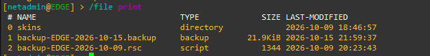

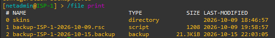

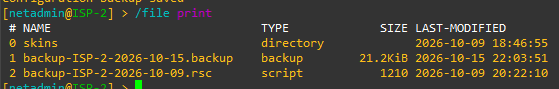

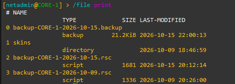

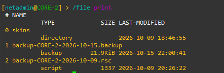

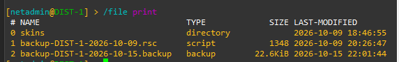

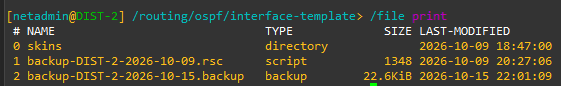

#### Snapshot BASE

Se creó el snapshot BASE en GNS3, con los nodos detenidos, después de configurar y verificar el direccionamiento y el hardening de F1.

Este snapshot conserva el estado base de F1; no representa las configuraciones posteriores de F2 y F3.

#### Prueba de restauración de F2

El 15/10 se probó la restauración de CORE-1 con el archivo `backup-CORE-1-2026-10-15.rsc`.

Antes del reset, CORE-1 tenía cuatro vecinos OSPF Full. Se ejecutó `/system reset-configuration no-defaults=yes skip-backup=yes`; el router volvió sin configuración, con identidad MikroTik, y el archivo `.rsc` se conservó en su almacenamiento.

La importación restauró la configuración sin errores. Los usuarios se recrearon manualmente: `netadmin`, `monitor` y `admin` deshabilitado.

CORE-1 recuperó sus cuatro adyacencias OSPF Full, las cinco direcciones IP y los servicios inseguros deshabilitados. La autenticación MD5 se recuperó porque el export local utilizado incluía la clave. Las copias censuradas del repositorio requieren reponerla.

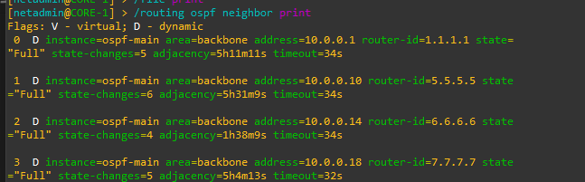

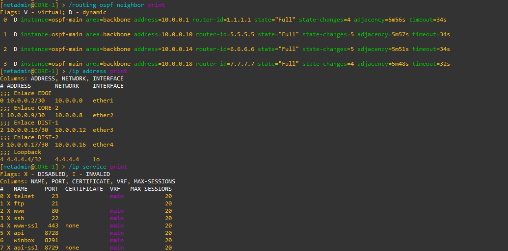

#### Exports de F3

El 16/10/2026 se generaron los exports finales de los tres routers modificados:

- `backup-EDGE-2026-10-16.rsc`
- `backup-ISP-1-2026-10-16.rsc`
- `backup-ISP-2-2026-10-16.rsc`

Se guardaron en `backups/`. El export final de EDGE contiene únicamente las dos conexiones BGP necesarias, después de eliminar las entradas duplicadas.

La clave OSPF visible en el export de EDGE se reemplazó por `REDACTED` en la copia destinada al repositorio. Las claves TCP-MD5 no aparecen en los exports obtenidos y deben reponerse al restaurar.

CORE-1, CORE-2, DIST-1 y DIST-2 no recibieron cambios de configuración durante F3 y conservan sus exports posteriores a F2. Las rutas aprendidas dinámicamente no requieren modificar sus configuraciones.

Antes de iniciar F3 se generaron exports `pre-F3` en EDGE y ambos ISP como referencia local del estado anterior.

#### Backups binarios de F3

El 16/10/2026 se generaron backups binarios cifrados de EDGE, ISP-1 e ISP-2, posteriores a la configuración de BGP y del firewall.

Se utilizó cifrado `aes-sha256` con una contraseña guardada fuera del repositorio. Los archivos contienen usuarios y claves, permanecen en el almacenamiento de los routers y no se versionan.

Se comprobó su existencia mediante `/file print`, verificando que los archivos `.backup` tenían tamaño mayor que cero.

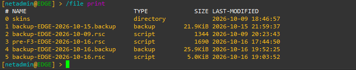

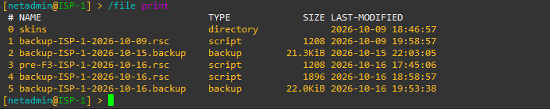

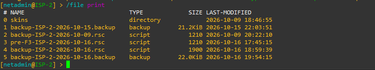

#### Prueba de restauración de F3

El 16/10/2026 se probó la restauración de ISP-2 desde el archivo `backup-ISP-2-2026-10-16.rsc` en una copia aislada del proyecto GNS3. El proyecto original permaneció detenido durante la prueba.

Antes del reset se registraron la identidad ISP-2, las direcciones `198.51.100.1/30` y `3.3.3.3/32`, la sesión eBGP establecida con EDGE y las rutas BGP hacia `192.168.10.0/24` y `192.168.20.0/24`.

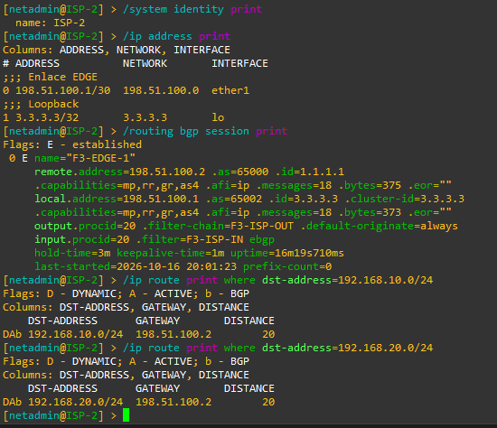

Se ejecutó `/system reset-configuration no-defaults=yes skip-backup=yes`. Después del reinicio se comprobó que el router tenía identidad MikroTik, sin direcciones IP ni conexiones BGP configuradas, y que el archivo `.rsc` se conservaba en su almacenamiento.

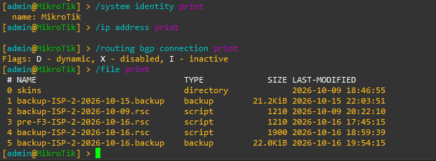

Se importó el archivo mediante `/import file-name=backup-ISP-2-2026-10-16.rsc`. La importación finalizó correctamente.

La clave TCP-MD5 se repuso manualmente, porque el export no la incluía. También se recrearon los usuarios `netadmin` y `monitor`, utilizando el grupo `monitoring` restaurado por el export. Después de comprobar el acceso con `netadmin`, se deshabilitó el usuario `admin`.

Se verificó la recuperación de:

- La identidad ISP-2.
- Las direcciones `198.51.100.1/30` y `3.3.3.3/32`.
- La sesión eBGP establecida con EDGE.
- Las rutas BGP hacia las dos LAN.
- Los usuarios y sus grupos.
- Los servicios deshabilitados conforme al hardening.
- Las interfaces Ethernet sin uso deshabilitadas.
- El cliente DHCP de ether1 deshabilitado.

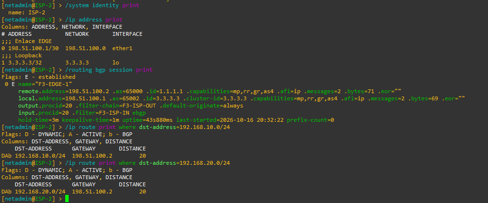

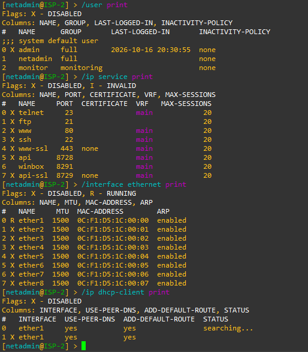

Finalmente, PC-USER volvió a alcanzar la loopback `3.3.3.3` mediante ping y traceroute.

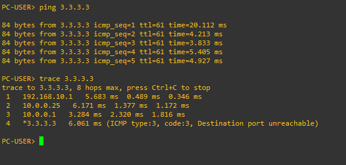

La prueba verificó la restauración desde el export textual `.rsc`, con reposición manual de usuarios y clave BGP. No se probó la restauración desde los archivos binarios `.backup`.

Mantener los backups binarios únicamente dentro de los routers constituye una limitación: no protege frente a la pérdida del almacenamiento del proyecto.

#### Exports y backup binario de F4

Durante F4 solo DIST-1 recibió un cambio de configuración: los cinco chequeos de Netwatch de la sección 6.3. La ruta de prueba agregada en EDGE para el Drill 4 se eliminó al terminar, y la clave OSPF de CORE-1 se restauró después de la verificación de seguridad, por lo que ambos routers conservan sus configuraciones anteriores.

El 20/10/2026 se generó el export `backup-DIST-1-2026-10-20.rsc`, guardado en `backups/`. La clave OSPF visible en el export se reemplazó por `REDACTED` en la copia destinada al repositorio. Se verificó que `dhcp-client` figura con `disabled=yes`. Respecto del export de F2, el único cambio es el bloque `/tool netwatch`.

También se generó un backup binario cifrado de DIST-1 (`backup-DIST-1-2026-10-20.backup`, 23,5 KiB). Se cifró con una contraseña guardada fuera del repositorio, permanece en el almacenamiento del router y no se versiona. Su existencia se comprobó con `/file print`.

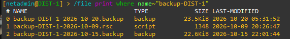

No se realizó una prueba de restauración posterior a F4; la última corresponde a F3 (ISP-2). Se mantiene la limitación de que los backups binarios solo residen en los routers.

#### Exports de F5

El 21/10/2026 se generaron nuevos exports de DIST-1 y DIST-2 después de corregir las máscaras de las direcciones virtuales VRRP a /32 y verificar conectividad, roles VRRP y adyacencias OSPF.

Los archivos se guardaron en `backups/`:

- `backup-DIST-1-2026-10-21.rsc`
- `backup-DIST-2-2026-10-21.rsc`

Las claves OSPF visibles se reemplazaron por `REDACTED` en las copias destinadas al repositorio. Ambos archivos se utilizaron para actualizar las configuraciones correspondientes en `configs/final/`.

Estos exports documentan el estado posterior a la corrección de F5. Los backups binarios y las pruebas de restauración anteriores corresponden a las fechas y configuraciones descritas en sus respectivas secciones.

### 6.3 Monitoreo

Se implementaron chequeos activos con Netwatch en DIST-1, con intervalo de 10 s y registro de cada cambio de estado en el log. No se habilitó SNMP: el laboratorio no dispone de un cliente SNMP para verificarlo y la comunidad sería un secreto adicional fuera del repositorio.

| Chequeo | Destino | Qué verifica |
|---------|---------|--------------|
| ISP-1-lo | 2.2.2.2 | Camino completo hasta el loopback de ISP-1 |
| ISP-2-lo | 3.3.3.3 | Camino completo hasta el loopback de ISP-2 |
| SRV | 192.168.20.100 | LAN de servidores |
| CORE-1 | 10.0.0.13 | Enlace DIST-1 ↔ CORE-1 |
| CORE-2 | 10.0.0.21 | Enlace DIST-1 ↔ CORE-2 |

Los chequeos hacia los ISP quedaron inicialmente en `down` sin falla real: los ISP no tienen ruta hacia 10.0.0.0/24 porque EDGE solo anuncia las LAN. Se corrigió fijando `src-address=192.168.10.2`.

Prueba: al deshabilitar `ether1` de ISP-1, `ISP-1-lo` pasó a `down` en ≈ 8 s y volvió a `up` ≈ 10 s después de restaurarlo; los otros cuatro chequeos no cambiaron. Las tablas de ruteo de DIST-1 se documentaron con `/routing route print`. Detalle en `runbooks/monitoreo-netwatch.md`.

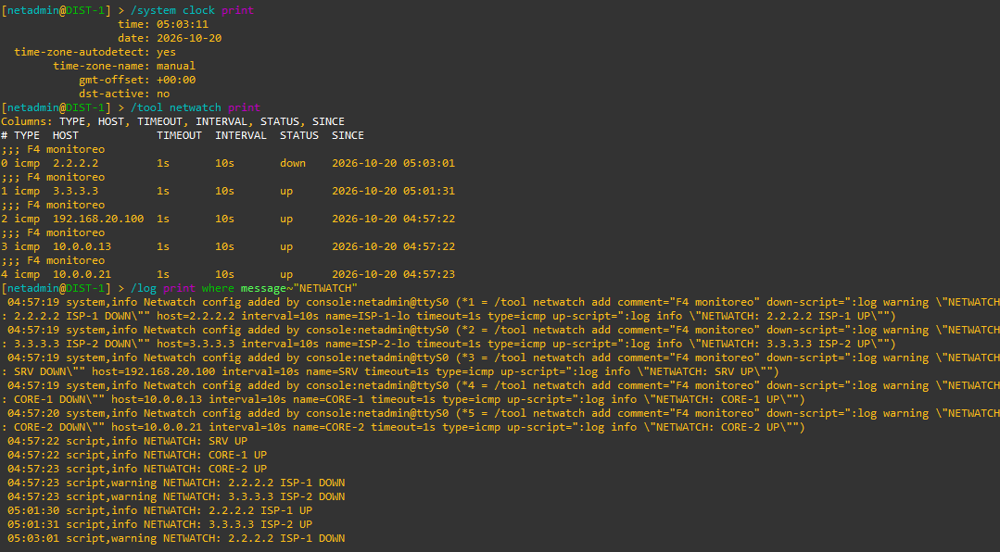

Limitaciones: monitoreo local en un solo router, sin alertas externas ni métricas históricas. Los chequeos de Netwatch están configurados en DIST-1 y se incluyen en su export posterior a F4 y en su configuración final de F5. No figuran en los exports anteriores a F4.

---

## 7. Capturas

Las evidencias están organizadas por fase:

| Directorio | Contenido |
|------------|-----------|
| `capturas/F1/` | Topología, direccionamiento, hardening, acceso de monitor, pings directos y snapshot BASE. |
| `capturas/F2/` | OSPF, VRRP, conectividad entre LAN, comprobación funcional de failover, backups binarios y restauración de CORE-1. |
| `capturas/F3/` | Sesiones BGP, comprobación de TCP-MD5 sin revelar claves, rutas, salida por OSPF, pings, traceroutes y firewall. |
| `capturas/F4/` | Drills 1 a 5, verificación de clave OSPF MD5 incorrecta y monitoreo con Netwatch. Prefijos `F4-drillN-`, `F4-seguridad-` y `F4-monitoreo-`. |
| `capturas/F5/` | Verificación final del proyecto y comprobaciones posteriores a la corrección de las máscaras VRRP. |

Los nombres de archivos deben coincidir con los enlaces utilizados en esta memoria. Las imágenes no deben mostrar claves vigentes.

---

## 8. Conclusiones y lecciones aprendidas

El laboratorio permitió integrar VRRP, OSPF y eBGP para proporcionar redundancia en diferentes partes de la red. VRRP mantiene un gateway disponible para cada LAN, OSPF permite utilizar caminos internos alternativos y eBGP ofrece una salida por un segundo proveedor. El funcionamiento conjunto se comprobó mediante las verificaciones de conectividad y los escenarios documentados en F4.

Los resultados mostraron la importancia del mecanismo de detección. En el escenario VRRP se estimó una interrupción de aproximadamente 2,8 s, con la incertidumbre indicada en el runbook. En el corte OSPF se observó un paquete perdido durante la falla y otro durante la recuperación, sin una medición precisa del tiempo de interrupción. BGP detectó la caída al vencer el hold timer, aproximadamente 129 s después del corte según los relojes registrados. La ruta estática de prueba con check-gateway cambió al gateway de respaldo en aproximadamente 28 s. Estos resultados corresponden a pruebas diferentes y deben interpretarse con sus respectivas limitaciones.

El escenario de load-sharing confirmó que ambos routers de distribución pueden trabajar simultáneamente, cada uno como master de un grupo VRRP. El reparto se realiza por LAN y no garantiza una distribución uniforme del tráfico. Este escenario no incluyó una falla ni una medición de convergencia.

La prueba con una clave OSPF MD5 incorrecta produjo rechazos de autenticación y la caída de la adyacencia observada. Al restaurar la clave vigente se recuperaron las adyacencias. Los chequeos Netwatch permitieron detectar cambios de disponibilidad y mostraron que el origen de los sondeos debe disponer de una ruta de retorno. Sus alertas son informativas: no se configuraron acciones de failover mediante Netwatch.

Las pruebas de restauración permitieron identificar los elementos que deben reponerse al utilizar exports: usuarios, contraseñas y claves omitidas o censuradas. Los respaldos fechados, las evidencias y el historial de Git facilitaron la trazabilidad. Durante F5 se corrigieron las máscaras de las direcciones virtuales VRRP a /32 y se verificaron nuevamente los roles, las adyacencias OSPF y la conectividad. Los tiempos de F4 corresponden al estado anterior a esta corrección y no se volvieron a medir en F5.

La arquitectura mantiene limitaciones conocidas. EDGE continúa siendo un punto único de falla. La loopback de cada ISP depende de ese proveedor, por lo que el cambio de la ruta por defecto demuestra la selección del proveedor alternativo, pero no la continuidad hacia un destino común. El monitoreo es local y los backups binarios permanecen en el almacenamiento de los routers. Como mejoras se proponen evaluar BFD o ajustes de timers, redundancia de EDGE, monitoreo externo y respaldos fuera de los equipos.

El detalle de los procedimientos, las evidencias, las mediciones y sus limitaciones se conserva en los runbooks de F4 y en `runbooks/post-mortem-global.md`.

## 9. Referencias

- Documentación oficial de MikroTik RouterOS: VRRP, OSPF, BGP, firewall y gestión de configuraciones.
- RFC 5798: Virtual Router Redundancy Protocol, versión 3.
- RFC 3768: Virtual Router Redundancy Protocol, versión 2.
- RFC 2328: OSPF Version 2.
- RFC 4271: A Border Gateway Protocol 4.
- RFC 2385: Protection of BGP Sessions via the TCP MD5 Signature Option.
- Diapositivas y material de cátedra: “Failover Routing”.
- Consigna del laboratorio: `spec-laboratorio-failover.md`.

---

## 10. Checklist de entrega

### Diseño (F0)

- [x] IPAM completo y sin solapamiento.
- [x] Corrección del diagrama justificada, con al menos tres defectos.
- [x] Política de seguridad definida: usuarios, servicios y manejo de claves.
- [x] Política de operación definida: change log y backups.

### Redes

- [x] 7 CHR, 2 switches y 2 hosts levantados y cableados.
- [x] VRRP operativo con dos grupos y reparto de carga.
- [x] OSPF área 0 con adyacencias, incluido core-core.
- [x] Dos sesiones eBGP establecidas.
- [x] Ambas LAN anunciadas a los dos ISP mediante OSPF→BGP.
- [x] PC-USER alcanza las loopbacks de ambos ISP.
- [x] Cinco drills ejecutados y documentados con runbook, post-mortem y tiempos registrados en los escenarios con falla.

### Seguridad

- [x] Hardening aplicado: usuarios, contraseñas y servicios deshabilitados.
- [x] OSPF MD5 funcionando.
- [x] BGP TCP-MD5 funcionando.
- [x] Autenticación VRRP funcionando.
- [x] Firewall IPv4 de EDGE aplicado.
- [x] Winbox de EDGE restringido al origen autorizado.
- [x] Bloqueo de TCP/8291 desde ISP-1 verificado.
- [x] Prueba de autenticación con clave incorrecta documentada (OSPF).

### Operación

- [x] Change log documentado hasta `ebc84ee`; el commit de cierre queda registrado en el historial de Git.
- [x] Exports posteriores a F1 y F2 generados.
- [x] Exports finales de EDGE e ISP posteriores a F3 generados y revisados.
- [x] Restauración desde export probada en CORE-1 durante F2.
- [x] Backups binarios cifrados de F2 documentados.
- [x] Backups binarios posteriores a F3 generados y documentados.
- [x] Export y backup binario de DIST-1 posteriores a F4 generados y documentados.
- [x] Restauración de un nodo con configuración posterior a F3 probada.
- [x] Monitoreo habilitado y documentado.
- [x] Runbook por drill y post-mortem global.

### Entrega

- [x] Memoria completa, incluidas F4 y F5.
- [x] Repositorio con estructura y trazabilidad de commits revisados para la entrega final.
- [x] Backlog con todos los criterios de aceptación cumplidos.
- [x] Evidencias completas de todas las fases en `capturas/`.
- [x] Configuraciones finales organizadas en `configs/`.
- [x] Cada integrante puede defender su parte y una parte ajena.